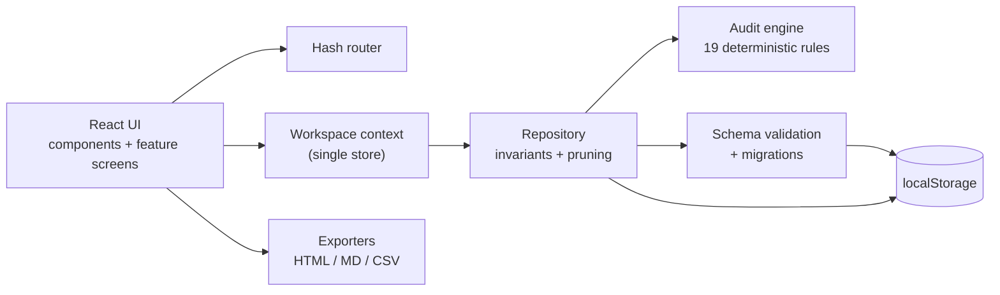

# a11y-workbench

**A client-side accessibility audit workbench** — capture a page's HTML, run a
deterministic WCAG 2.2-oriented audit, triage the findings with an audit trail,
and produce a VPAT-style report you can hand to a reviewer.

Everything runs in the browser. No server, no account, no upload: captured markup
never leaves the machine it was pasted on.

---

## Why it exists

Accessibility audits are usually assembled from three disconnected tools: a
scanner that prints findings to a console, a spreadsheet for triage, and a
document editor for the report. The evidence is lost between them, so nobody can
answer *“why was this marked fixed, by whom, against which rule version?”* six
months later.

`a11y-workbench` keeps the whole chain in one place:

```
capture → audit (immutable result) → triage (status + note) → report (export)
```

* The **capture** is the evidence and is stored verbatim.
* The **audit result** records the engine version and the rule that fired, so a
  finding can always be reproduced.
* **Triage** records a decision and a note per finding, with a timestamp.
* The **report** is generated from current triage state and states its own
  limitations instead of over-claiming conformance.

## Product overview

| Screen | What it is for |
| --- | --- |
| **Overview** | Workspace health: open findings by severity, projects, most frequent failures, onboarding when new. |
| **Projects** | One project per product or site; search, open findings, last scan. |
| **Project detail** | The working surface: capture pages, review scans, edit scope, open the report. |
| **Findings** | Global inbox across all scans with project / severity / status / text filters and inline triage. |
| **Scan detail** | Evidence for one capture: metadata, severity counts, findings, captured markup. |
| **Reports** | Per-project VPAT-style conformance summary; export HTML, Markdown or CSV; print. |
| **Contrast checker** | WCAG 2.2 AA/AAA contrast maths for colours that a static capture cannot evaluate. |
| **Rule reference** | What each rule checks, its severity, WCAG level and success criteria — generated from the engine. |
| **Settings** | Theme, storage usage, backup export / restore, reset, operational limits, privacy notes. |

## Key capabilities

* **19 deterministic rules** covering text alternatives, names and roles, form
  labelling, heading order, landmarks, keyboard operability, ARIA validity,
  table and list structure, inline-style contrast, and page metadata.
* **Repeatable output** — same markup and engine version always produce the same
  findings in the same order.
* **Bulk triage** — mark a filtered set as fixed in one action.
* **Three exports** — standalone printable HTML, Markdown, and RFC-4180 CSV.
* **Bundled sample pages** — a failing page and an accessible baseline, so the
  product can be evaluated in two clicks and the tests exercise what users see.
* **Dark and light themes**, both audited against WCAG AA contrast.
* **Works offline** — the production build is static files with no network calls.
* **Versioned storage** with repair-on-load and explicit failure reporting.

## Technology stack

| Concern | Choice | Why |
| --- | --- | --- |
| UI | React 19 + TypeScript 5.9 (strict) | Typed data model; no runtime schema library needed. |
| Build | Vite 7 | Fast dev server, static output, built-in CSS handling. |
| Tests | Vitest 3 + Testing Library (jsdom) | Same runner for engine, storage and component tests. |
| Lint | ESLint 9 flat config + `jsx-a11y` + `react-hooks` | An accessibility product should lint for accessibility. |
| Styling | Hand-authored CSS with design tokens | Full control of contrast; no framework weight. |
| Router | ~100-line hash router | Static hosting anywhere without rewrite rules. |
| Persistence | `localStorage` behind a repository | Single user, offline, no backend to operate. |

No runtime dependency other than React and React DOM.

## Architecture summary



Layering is enforced by convention and documented in
[`docs/ARCHITECTURE.md`](docs/ARCHITECTURE.md): `types` ← `lib` ← `engine` /
`storage` ← `state` ← `features` / `components`. The engine knows nothing about
React, and the storage layer knows nothing about the engine.

## Repository structure

```
a11y-workbench/
├── index.html               # SPA shell (single mount point)
├── package.json             # scripts + pinned dependencies
├── vite.config.ts           # Vite, Vitest and alias configuration
├── tsconfig.json            # strict TypeScript
├── eslint.config.js         # flat ESLint config incl. jsx-a11y
├── .env.example             # documented build-time variables
├── public/favicon.svg
├── src/
│   ├── main.tsx             # entry: theme → providers → App
│   ├── App.tsx              # route table
│   ├── config.ts            # constants, limits, env parsing
│   ├── types/               # domain model + JSX bridge
│   ├── lib/                 # pure helpers: dom, color, format, id, download
│   ├── engine/              # audit engine + one file per rule
│   ├── storage/             # schema, migrations, localStorage, backup, repository
│   ├── state/               # workspace context, selectors, router
│   ├── hooks/               # theme hook
│   ├── components/          # ui primitives + layout shell
│   ├── features/            # one folder per screen
│   ├── samples/             # bundled capture fixtures
│   ├── styles/              # tokens, base, components CSS
│   └── test/                # setup, fixtures, integration + token tests
└── docs/                    # this documentation system
```

Full file-by-file detail: [`docs/PROJECT_STRUCTURE.md`](docs/PROJECT_STRUCTURE.md).

## Requirements

* **Node.js ≥ 20.19** (Vite 7 requirement; developed and verified on Node 22.22).
* **npm 10+** (or any client that honours `package-lock.json`).
* A modern evergreen browser for the app itself (Chromium 111+, Firefox 113+,
  Safari 16.4+ — required for `color-mix` and `:has` in the stylesheet).

## Installation

```bash
cd a11y-workbench
npm install
```

## Configuration

Copy `.env.example` to `.env.local` to change build-time limits. All values are
public (`VITE_` prefix), so never put secrets there.

| Variable | Default | Meaning |
| --- | --- | --- |
| `VITE_BASE_PATH` | `/` | Base path for the build (use `/repo-name/` on GitHub Pages). |
| `VITE_MAX_FINDINGS_PER_SCAN` | `400` | Findings kept per scan; extras are dropped with a warning. |
| `VITE_MAX_CAPTURE_KB` | `512` | Maximum accepted markup size per capture. |
| `VITE_MAX_SCANS_PER_PROJECT` | `25` | Scans retained per project; oldest are pruned. |

Details: [`docs/CONFIGURATION.md`](docs/CONFIGURATION.md).

## Development commands

```bash
npm run dev          # Vite dev server on http://localhost:5173
npm run test:watch   # Vitest in watch mode
npm run lint:fix     # ESLint with autofix
```

## Build commands

```bash
npm run typecheck    # tsc --noEmit
npm run lint         # eslint .
npm run test         # vitest run (all suites)
npm run build        # typecheck + production build into dist/
npm run preview      # serve the production build on :4173
npm run verify       # typecheck → lint → test → build (CI gate)
```

## Test commands

```bash
npm test                     # 242 tests across 12 files
npm run test:coverage        # v8 coverage report in coverage/
```

Current status: **242 tests passing**, `tsc --noEmit` clean, `eslint .` clean,
production build ~346 KB JS (108 KB gzipped) + 33 KB CSS (6.7 KB gzipped).

## Deployment overview

The build output is fully static — deploy `dist/` to any static host (GitHub
Pages, Netlify, S3, nginx). No server-side runtime, database or environment
secrets are involved. See [`docs/DEPLOYMENT.md`](docs/DEPLOYMENT.md).

## Environment variables

Only the four `VITE_*` variables above exist. There are **no secrets**, no API
keys and no external service credentials anywhere in this project. See
[`docs/ENVIRONMENT.md`](docs/ENVIRONMENT.md).

## Important limitations

These are deliberate and documented in the product itself:

1. **Static captures only.** External stylesheets, JavaScript interaction states
   (focus, hover, modals), PDFs, video captions and computed colours cannot be
   evaluated from pasted HTML. The report says so explicitly.
2. **Heuristic accessible-name computation.** Labelling is approximated
   (AccName 1.2) well enough to avoid false positives on correctly labelled
   controls, but it is not a full implementation.
3. **No automated conformance claim.** The report is evidence for an
   accessibility statement, not a certification.
4. **Single-browser storage.** The workspace lives in one browser profile's
   `localStorage`; there is no sync. Backup export is the migration path.
5. **Not a crawler.** Pages are captured one at a time.
6. **No real-browser end-to-end tests** in this environment (no headless browser
   available); DOM behaviour is covered in jsdom, and this gap is tracked in
   [`docs/TESTING.md`](docs/TESTING.md).

## Security considerations

* Captured markup is parsed with `DOMParser` in an inert document: **scripts do
  not execute** and subresources are not fetched.
* All user-controlled content is escaped in HTML exports and quoted in CSV.
* Captured markup is rendered only inside `<pre>` as text, never as HTML.
* Data is stored **unencrypted** in `localStorage` — use a dedicated browser
  profile for confidential audits. Documented in
  [`docs/SECURITY.md`](docs/SECURITY.md).

## Documentation

Start at [`docs/README.md`](docs/README.md) — the index of the whole system.

| Document | Contents |
| --- | --- |
| [docs/ARCHITECTURE.md](docs/ARCHITECTURE.md) | Subsystems, layering, diagrams, constraints. |
| [docs/PROJECT_STRUCTURE.md](docs/PROJECT_STRUCTURE.md) | Every directory and significant file. |
| [docs/SETUP.md](docs/SETUP.md) | From clone to running app. |
| [docs/CONFIGURATION.md](docs/CONFIGURATION.md) | Every configuration value. |
| [docs/DEVELOPMENT.md](docs/DEVELOPMENT.md) | Workflow and conventions. |
| [docs/TESTING.md](docs/TESTING.md) | Strategy, matrix, gaps. |
| [docs/DEPLOYMENT.md](docs/DEPLOYMENT.md) | Build → deploy → verify → rollback. |
| [docs/OPERATIONS.md](docs/OPERATIONS.md) | Running, monitoring, recovery. |
| [docs/TROUBLESHOOTING.md](docs/TROUBLESHOOTING.md) | Real problems and fixes. |
| [docs/SECURITY.md](docs/SECURITY.md) | Threat model and controls. |
| [docs/PERFORMANCE.md](docs/PERFORMANCE.md) | Measured numbers and optimisations. |
| [docs/ACCESSIBILITY.md](docs/ACCESSIBILITY.md) | The product's own a11y position. |
| [docs/CHANGELOG.md](docs/CHANGELOG.md) | What was built. |
| [docs/DOCUMENTATION_COVERAGE.md](docs/DOCUMENTATION_COVERAGE.md) | Audit matrix. |
