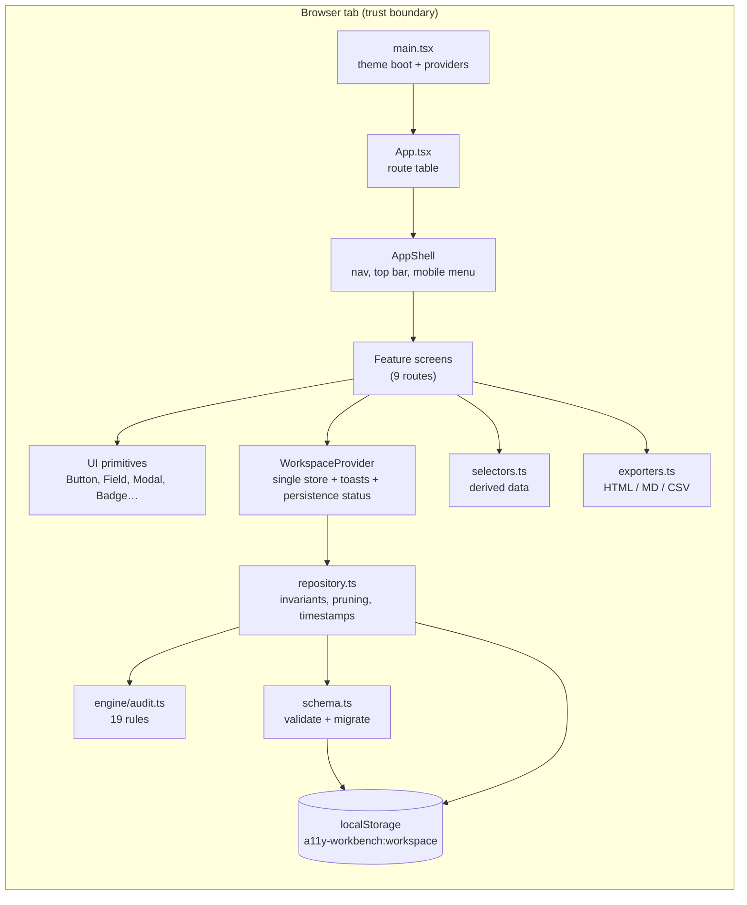
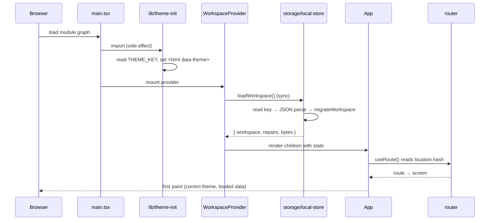
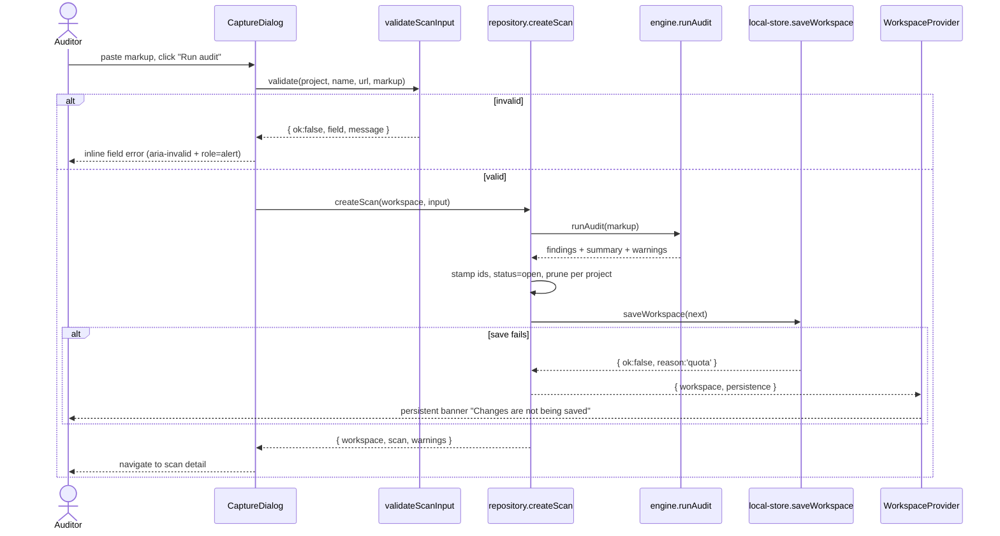

# Architecture

## 1. What the system is

A single-page application that runs entirely in the browser. There is no server,
no database process and no external API. The "backend" is a deterministic audit
engine plus a versioned document in `localStorage`.



Everything inside the browser is trusted to the extent the browser tab is; the
only untrusted input is the **captured markup**, which is handled by parsing it
into an inert document (see [`SECURITY.md`](SECURITY.md)).

## 2. Subsystems and responsibilities

| Subsystem | Location | Responsibility | Must never |
| --- | --- | --- | --- |
| Domain model | `src/types/domain.ts` | Field-level definition of persisted data, labels, ordering constants. | Import anything. |
| Utilities | `src/lib/*.ts` | Pure functions: DOM helpers, colour maths, formatting, ids, downloads. | Touch React or storage. |
| Audit engine | `src/engine/**` | Turn markup into `EngineFinding[]` + summary. | Read storage, mutate the DOM, use time or randomness. |
| Storage | `src/storage/**` | Validate, migrate, persist, back up, and enforce repository invariants. | Render, or import TSX. |
| State | `src/state/**` | Hold the workspace in memory, expose mutations, derive aggregates, route. | Contain presentation markup beyond the provider. |
| Components | `src/components/**` | Reusable UI primitives and the app shell. | Import `storage/**` or `engine/**` directly. |
| Features | `src/features/**` | One screen each: composition, local UI state, validation feedback. | Mutate the workspace object. |
| Styles | `src/styles/**` | Design tokens, base layer, component layer. | Hard-code colours outside `tokens.css`. |

Dependency direction is acyclic:

```
types  →  lib  →  engine
              ↘  storage  →  state  →  features → components
```

`config.ts` is a leaf that anything may import (it has no imports of its own
beyond Vite's `import.meta.env`).

## 3. Why this architecture

* **The engine is pure.** `runAudit(markup)` takes a string and returns a plain
  object. That is what makes 35 rule tests possible without a browser, and what
  makes the audit reproducible.
* **One write path.** Every persisted change goes through
  `storage/repository.ts`, which is where ids, timestamps, pruning and limits are
  enforced. Components cannot create an inconsistent workspace even by mistake.
* **One store.** The app has exactly one piece of shared state (the workspace).
  A reducer-style context exposes it; no state library was added because it would
  rename code without removing any.
* **Derived data is centralised** in `state/selectors.ts` so the numbers in the
  UI and the numbers in an exported report cannot diverge.
* **Routing is a hash router** so the static build works on any host, including
  sub-paths and `file://`, with no rewrite configuration.

The trade-offs and the decisions that must not be changed casually are recorded
in [`architecture/decisions.md`](architecture/decisions.md).

## 4. Initialisation sequence



Because `localStorage` is synchronous, the first paint already contains the
stored workspace — there is no empty→loaded flicker and no loading spinner for
the initial data. `ready` is exposed by the provider for future asynchronous
stores and to disable interactions until effects have run.

## 5. Control flow — a capture



## 6. State flow

```
user action → feature handler → context mutation function
            → repository function (pure, returns next workspace)
            → saveWorkspace (side effect, typed result)
            → setWorkspace + persistence error/toast
            → re-render → selectors recompute derived values
```

See [`architecture/state-management.md`](architecture/state-management.md) for
the full store contract.

## 7. Persistence and data lifecycle

| Stage | Behaviour |
| --- | --- |
| Write | Whole workspace serialised to one key on every mutation (documented trade-off — see decisions). |
| Read | `JSON.parse` → `migrateWorkspace` repairs, drops invalid records, recomputes summaries. |
| Versioning | `schemaVersion` stored; additive defaults handle older documents; newer documents are read with a warning. |
| Retention | Max 25 scans per project (configurable), max 100 projects, max 400 findings per scan. |
| Deletion | Project delete cascades to its scans. Scan delete removes its findings. |
| Backup | JSON export/import through the same validation path as storage. |

## 8. Error flow

| Failure | Detected by | Surfaced as |
| --- | --- | --- |
| Invalid JSON in storage | `loadWorkspace` | Warning banner list, workspace reset, `fresh:false` |
| Unusable document shape | `migrateWorkspace` (`reset:true`) | Warning banner |
| Storage unavailable | availability probe | Warning banner; app runs in memory |
| Quota exceeded on write | `saveWorkspace` | Persistent red banner + toast; change kept in memory |
| Rule throws | `runAudit` try/catch per rule | `warnings[]` on the scan + toast |
| Markup too large | `validateScanInput` | Inline field error before the engine runs |
| Unknown route / deleted entity | router + screen lookup | Not-found screen with recovery actions |
| Render crash | `ErrorBoundary` | Recoverable screen with technical details |

Full detail: [`architecture/error-handling.md`](architecture/error-handling.md).

## 9. Shutdown

There is no shutdown sequence: the app is a tab. The only teardown work is in
effect cleanups — toast timers, theme media-query listener, modal scroll lock and
focus restoration. Reload is safe at any point because state is persisted on
write, not on unload.

## 10. Architectural constraints

1. **No network at runtime.** Adding a fetch would invalidate the privacy model
   and the offline story.
2. **No mutation of parsed documents inside rules.** Caches in `lib/dom.ts` rely
   on this; mutating would produce stale hidden/label results.
3. **Rule ids are permanent.** Stored findings reference them; renaming breaks
   historical evidence.
4. **One storage key.** Split keys would require cross-key transaction handling
   that `localStorage` cannot provide.
5. **Colours only in `tokens.css`.** Enforced by review and by
   `src/test/tokens-contrast.test.ts`.

## 11. Technical debt (honest list)

| Item | Impact | Trigger to pay it down |
| --- | --- | --- |
| Whole-workspace serialisation per write | ~1-3 ms per save at realistic sizes; grows with scan count | Moving to IndexedDB or >1000 scans in one workspace |
| Accessible-name computation is heuristic | Conservative (avoids false positives) but incomplete | When audits need to *certify* labelling |
| Inline-style-only contrast rule | External CSS is never evaluated | A CSS parser or computed-style capture feature |
| No real-browser E2E tests | Regression risk in layout/responsive behaviour | A CI runner with Playwright available |
| Findings list renders 25 at a time (no virtualisation) | Fine to ~1000 findings | If projects routinely exceed a few thousand findings |

These are tracked so nobody mistakes them for oversights.
