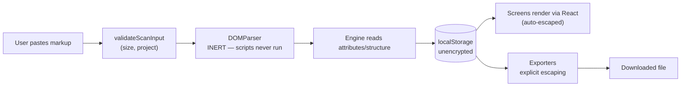

# Security

## Threat model

| Asset | Where it lives | Sensitivity |
| --- | --- | --- |
| Captured page markup | `localStorage`, unencrypted | **High** — may contain client HTML, personal data, hidden fields |
| Audit notes / findings | `localStorage`, unencrypted | Medium |
| Backup files | User's filesystem | High (same content) |
| Exported reports | User's filesystem / email | Medium–high |

| Adversary | Capability | Mitigation |
| --- | --- | --- |
| Malicious markup pasted for audit | Arbitrary HTML incl. `<script>`, ``, event handlers | Inert parsing (`DOMParser`), never inserted into the app document, HTML-escaped wherever displayed |
| Another script on the same origin | Can read `localStorage` | No third-party scripts; host-level CSP recommended; documented caveat |
| Someone with the device/profile | Can read `localStorage` and backup files | Out of scope; stated in the UI. Use OS-level disk encryption |
| Network attacker | Nothing to intercept — no requests | No runtime network |
| Supply chain | Could affect the build | 2 runtime deps, lockfile, no post-install scripts from exotic packages |
| CSV/HTML export opened elsewhere | Formula injection, XSS | CSV neutralisation + HTML escaping |

**Not in the threat model:** a compromised browser, a malicious browser extension,
or a user pasting markup they are not authorised to hold.

## Data flow and trust boundaries



Trust boundaries:

1. **Markup → `DOMParser`.** Everything after this point sees an inert document.
2. **Disk → `migrateWorkspace`.** Untrusted JSON is normalised, never trusted.
3. **Backup file → `parseBackup`.** Size-capped, JSON-parsed, then migrated.
4. **Data → exporters.** Every interpolated value is escaped.

## XSS defence in depth

| Layer | Mechanism |
| --- | --- |
| Parsing | `new DOMParser().parseFromString(markup, 'text/html')` — an inert document; no script execution, no resource loading |
| Never injected | The captured markup is never assigned to `innerHTML`, `dangerouslySetInnerHTML`, `srcdoc` or `document.write` anywhere in `src/` |
| Display | Captured snippets are rendered as React text (escaped by React) inside `<pre>` |
| Copy path | `navigator.clipboard.writeText` (text, not HTML) |
| HTML report | `escapeHtml` on every interpolated value, verified by a test with `<script>` and `"` payloads |
| Markdown | Pipes escaped, newlines collapsed |
| CSV | RFC 4180 quoting **plus** `= + - @ <tab> <CR>` neutralisation |

Verified by search: no `innerHTML`/`dangerouslySetInnerHTML` in application code;
the only HTML string produced is the report, built with escaping (test asserts the
payload appears literally).

## Storage security

| Property | Status |
| --- | --- |
| Encrypted at rest | **No** — `localStorage` is plain text |
| Accessible to same-origin JS | Yes |
| Accessible to other origins | No |
| Cleared by | User, browser eviction, private-window close |
| Backups encrypted | No |

**Recommendation stated in the UI:** do not paste markup containing credentials,
tokens or personal data you are not permitted to retain. Settings says this
explicitly.

Encrypting client-side was considered and rejected: without a passphrase UX and a
key-recovery story, encryption gives a false sense of security, and a passphrase
prompt on every load would harm the primary use case. This is a documented
trade-off, not an oversight.

## Content Security Policy

The build does not inject a CSP (a static `index.html` cannot know the host). A
policy that matches the app's actual requirements:

```http
Content-Security-Policy:
  default-src 'self';
  script-src 'self';
  style-src 'self' 'unsafe-inline';
  img-src 'self' data:;
  font-src 'self';
  connect-src 'none';
  object-src 'none';
  base-uri 'none';
  form-action 'none';
  frame-ancestors 'none'
```

Notes on each unusual directive:

* `style-src 'unsafe-inline'` — React sets inline `style` attributes for the
  proportional severity bar and the error boundary. There is no inline `<style>`
  block in the app shell, and no `eval`.
* `connect-src 'none'` — the app makes no requests; this makes that guarantee
  enforced rather than aspirational.
* `img-src data:` — the inline SVG favicon.
* `frame-ancestors 'none'` — the app has no embed use case. If it must be embedded,
  use `SAMEORIGIN` and keep `X-Frame-Options` consistent.

Test the policy before enabling it on a host: a violation appears as a console
error and a broken style. It has **not** been browser-verified here (no browser
available); it is derived from the code's actual resource usage.

## Other headers

| Header | Recommended value |
| --- | --- |
| `X-Content-Type-Options` | `nosniff` |
| `Referrer-Policy` | `no-referrer` (there are no outbound links, so nothing is lost) |
| `Permissions-Policy` | `camera=(), microphone=(), geolocation=()` |
| `Strict-Transport-Security` | `max-age=31536000` (once HTTPS is stable) |

## Input validation

| Input | Validation |
| --- | --- |
| Project name/description/owner | Required where applicable, length-bounded, trimmed |
| Capture markup | Non-empty, ≤ byte limit (UTF-8), project must exist |
| URL | Length-bounded (not fetched, so not a SSRF surface) |
| Auditor note | ≤ 500 chars |
| Colour input | Parsed strictly; invalid values produce `null`, never a guess |
| Backup file | ≤ 40 MB, JSON, migrated |
| Route segments | Parsed, never used as a query or a path |

No input is used to build a SQL query, a shell command, a filesystem path or a
request.

## Secrets

There are **no** secrets in the repository:

* No API keys, tokens or credentials.
* `.env*` is git-ignored; `.env.example` contains only limit values.
* Vite `VITE_*` variables are public by definition and only carry integers.

## Dependency risk

| Control | Status |
| --- | --- |
| Runtime dependencies | 2 (`react`, `react-dom`) |
| Lockfile committed | Yes (468 entries) |
| Exact versions | Yes for runtime deps |
| `npm audit` | Run before each release; no known advisories at time of writing (verify, do not assume) |
| Install scripts | Not disabled globally; review any new dependency with a post-install script |

## Reporting a vulnerability

Include: affected version (`Settings` shows `APP_VERSION`), browser, reproduction
(captured markup snippet if relevant), and impact. Do not include real client
markup in a report; reduce it to a minimal reproduction.

## Known limitations (honest)

| Limitation | Impact | Accepted because |
| --- | --- | --- |
| Unencrypted `localStorage` | Same-origin script or device access reads data | Encryption without key management is theatre |
| No CSP shipped by default | Host must add one | Static artefact cannot know the host; policy documented above |
| No integrity/SRI for the bundle | A compromised host can serve altered JS | Self-hosted static artefact; SRI would need a per-build hash injection |
| Source maps published by default | Full source is visible to visitors | Deliberate for debuggability; `VITE_SOURCEMAP=false` to omit. Source disclosure is not a data leak — user data never leaves `localStorage` |
| Clipboard writes are silent on insecure contexts | Copy button appears to do nothing | Guarded; the value is visible on screen |
| Backup import accepts a foreign but structurally valid file | A wrong-but-valid workspace can replace data | The user confirms; migration bounds every field |
