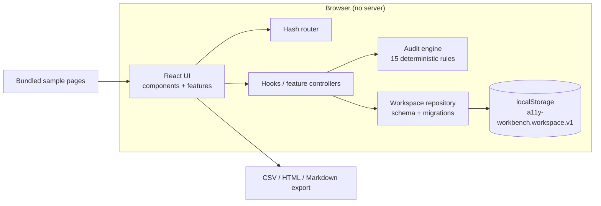
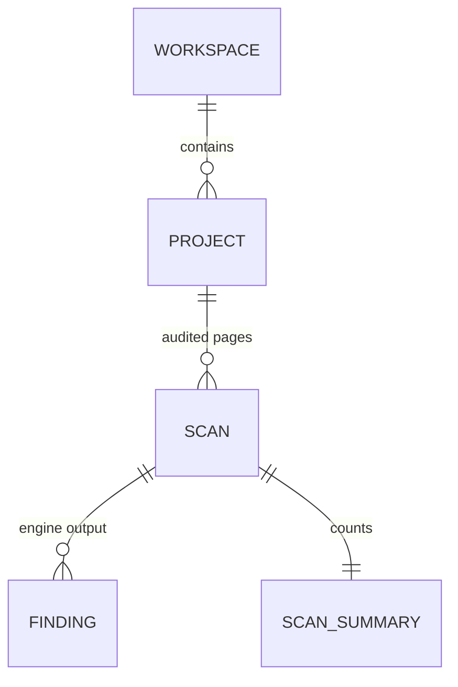

# Design: a11y-workbench

## 1. Problem statement

Accessibility audits are usually performed by pasting markup into third-party
tools, hand-writing findings into spreadsheets, and manually assembling a VPAT
report. That workflow is slow, non-repeatable and loses evidence: the markup
captured, the finding, the rule version and the report are never stored together
in one auditable trail.

`a11y-workbench` solves this by keeping capture → audit → triage → report in a
single local workspace:

1. A workspace holds **projects** (a product or site being audited).
2. Each project holds **scans** — a captured page (name, URL/context, CMS
   template, markup) plus the immutable engine result for that capture.
3. Each scan result contains **findings** — one per violated rule instance,
   carrying severity, WCAG success criteria, evidence and remediation guidance.
4. Findings are **triaged** (open → in progress → fixed / accepted / ignored)
   with a note, so progress is measurable.
5. The **report** view aggregates findings into a VPAT-style, printable,
   exportable document (HTML, Markdown, CSV).

## 2. Product decisions

| Decision | Choice | Reason |
| --- | --- | --- |
| Deployment model | 100% client-side SPA, no backend | Audit markup is often confidential pre-release code. Keeping it in the browser removes a data-exfiltration path and removes all server ops. |
| Persistence | `localStorage` behind a repository interface | Enough for a single auditor's workspace; swap-able interface keeps a future server store a contained change. |
| Audit engine | Own deterministic DOM rule engine (not axe-core) | No runtime dependency, fully testable, explainable rule semantics, no CDN/CSP issues. |
| Routing | Hash-based router (no router dependency) | Static hosting anywhere (GitHub Pages, file server) without rewrite rules; avoids an extra dependency for 9 routes. |
| Styling | Hand-authored CSS design system with tokens | Full control of contrast (an accessibility product must pass its own audit); no CSS framework weight. |
| Report format | Printable HTML + Markdown + CSV | VPAT reviewers want a document; engineers want CSV. |

## 3. Architecture

### Layer rules

| Layer | May depend on | Must not depend on |
| --- | --- | --- |
| `src/types` | nothing | everything |
| `src/engine` | `types`, `lib/dom` | React, storage |
| `src/storage` | `types`, `lib` | React, engine |
| `src/state` | `types`, `storage`, `engine`, `lib` | UI components |
| `src/components` | `types`, `lib`, `state` (via props/hooks) | `storage`, `engine` directly |
| `src/features` | all of the above | each other's internals (only public exports) |

## 4. Data model

Full field-level schema: [`../database/schema.md`](../database/schema.md).

## 5. Audit engine design

* **Rule contract** — each rule is a pure function `(context) => FindingDraft[]`
  over a parsed `Document`, so rules are unit-testable against fixtures without a
  browser.
* **Severity** — `critical | serious | moderate | minor`, derived from
  WCAG level plus impact, and used for sorting and reporting.
* **Evidence** — every finding stores a stable CSS-ish selector path, element
  snippet (truncated, HTML-escaped when rendered) and the rule id + engine
  version, so a finding can be reproduced later.
* **Determinism** — rules run in a fixed order; output is sorted by severity then
  rule id, so re-scanning identical markup yields identical findings.

## 6. Error, empty and loading states

Every asynchronous or fallible surface has four designed states: loading
(skeletons/aria-busy), empty (explains next action), error (human message +
technical detail disclosure), success (toast with undo where destructive).

## 7. Accessibility of the product itself

The workbench is audited with its own engine and follows: semantic landmarks,
visible focus rings, 44px minimum touch targets, `aria-live` status regions, no
color-only severity (icon + label + text), full keyboard operation, and reduced
motion support.

## 8. Testing strategy

| Layer | Approach |
| --- | --- |
| Engine | Fixture-driven unit tests: each rule has violating + passing markup. |
| Storage | Unit tests for validation, migration, quota/failure handling. |
| Reducers/selectors | Unit tests for state transitions and derived statistics. |
| Components | Testing Library tests for keyboard, labels, empty/error states. |
| Integration | jsdom end-to-end-ish happy path: create project → scan → triage → export. |

No claim is made for real-browser E2E (Playwright) — it is out of scope for this
client-only package and is listed as a known gap in
[`../TESTING.md`](../TESTING.md).
