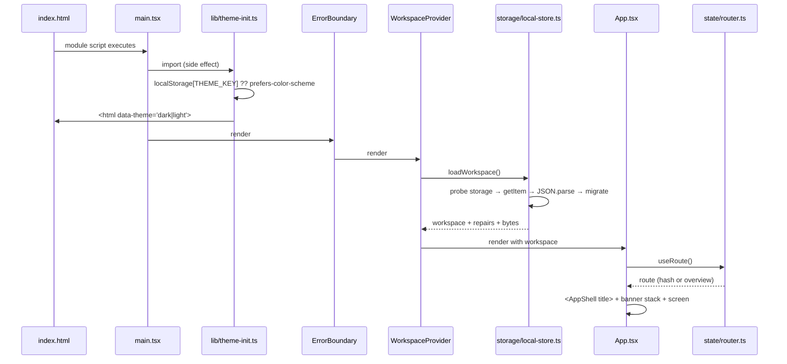
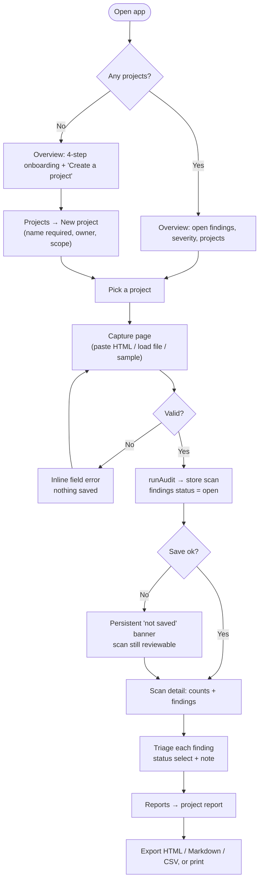

# Application flow

## Boot sequence



Failure branches at boot:

| Step | Failure | Result |
| --- | --- | --- |
| Theme | `localStorage` throws | Falls back to light theme, no message (cosmetic only) |
| Load | Key missing | Empty workspace, onboarding shown, no warning |
| Load | Invalid JSON | Empty workspace + warning banner "not valid JSON… was reset" |
| Load | Unrecognised shape | Empty workspace + warning banner |
| Load | Storage unavailable | Empty workspace + warning "changes will not be saved" |
| Render | Exception | `ErrorBoundary` recoverable screen with stack in `<details>` |

## Routing

Route grammar (implemented in `src/state/router.ts`):

| Hash | Route name | Screen |
| --- | --- | --- |
| `#/` | `overview` | `OverviewScreen` |
| `#/projects` | `projects` | `ProjectsScreen` |
| `#/projects/:id` | `project` | `ProjectDetailScreen` |
| `#/findings` | `findings` | `FindingsScreen` |
| `#/findings/:scanId` | `scan` | `ScanDetailScreen` |
| `#/reports` | `reports` | `ReportsScreen` |
| `#/reports/:projectId` | `report` | `ReportDetailScreen` |
| `#/contrast` | `contrast` | `ContrastScreen` |
| `#/rules` | `rules` | `RulesScreen` |
| `#/settings` | `settings` | `SettingsScreen` |
| anything else | `not-found` | `NotFoundScreen` |

* Navigation is `<a href="#/…">` everywhere, so middle-click, "open in new tab"
  and browser history all work without JavaScript handlers.
* An empty hash is normalised to `#/` with `location.replace`, so Back does not
  bounce through an empty URL.
* An unknown path renders `NotFoundScreen` rather than falling back to the
  overview — landing on a plausible-looking screen after a typo hides broken
  links.
* A known route with a missing/deleted id renders the "gone" variant with
  recovery actions.

## Primary user flow: first audit



## Secondary flows

### Triage from the global inbox

```
Findings → filter (project / severity / status / search)
        → change status on a row  → persisted immediately, toast confirms
        → add a note (saved on blur) → stored with an updatedAt timestamp
```

Designed so a fix round across many pages does not require opening each scan.

### Bulk close-out

```
Scan detail → choose severity filter
           → "Mark filtered as fixed"
           → bulkSetFindings(scanId, visibleIds, 'fixed')
           → one write, one toast
```

### Backup and restore

```
Settings → Export backup (JSON)         → downloads { app, exportedAt, workspace }
Settings → Restore backup → file input  → parseBackup → migrateWorkspace
                                       → replaceWorkspace (full replacement)
                                       → success toast with repair count, if any
```

Restore **replaces** the workspace; the UI says so before the user picks a file.

### First-run evaluation with samples

```
Projects → New project → Capture page → "Failing page" → Run audit
   → 20 findings across every rule category
   → "Accessible page" → Run audit → explicit "passed every rule" state
```

Both sample pages are also the fixtures used by the engine tests, so the demo
cannot drift from the tested behaviour.

## Screen-level state machines

Most screens are pure functions of `workspace` + route, which is what makes deep
links work after reload. The three screens with real local state:

| Screen | Local state | Reset on |
| --- | --- | --- |
| `CaptureDialog` | field values, file error, computed byte usage | open/close |
| `FindingsScreen` | four filters + page size | never (session-scoped, intentionally sticky while triaging) |
| `ScanDetailScreen` | severity filter, markup visibility, delete confirmation | navigation |

The two-step delete confirmation (button becomes "Confirm") exists because a
single mis-click should not destroy a scan; it is intentionally **not** a modal
(the action is reversible until confirmed, and a modal for a two-click pattern
adds a focus trap for no benefit).
