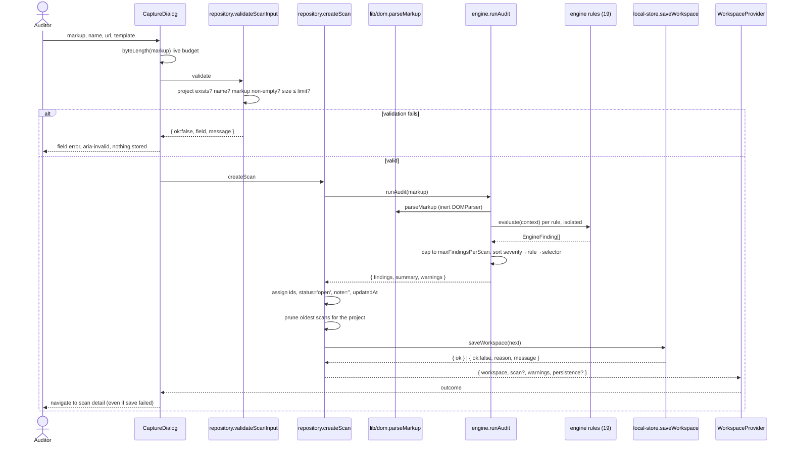
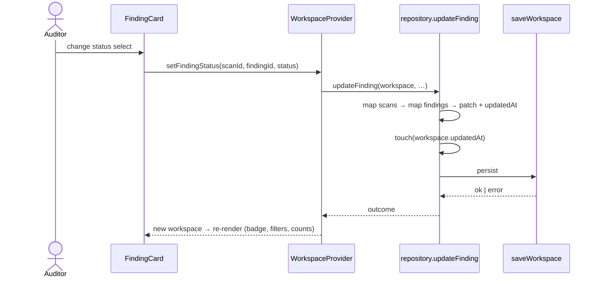
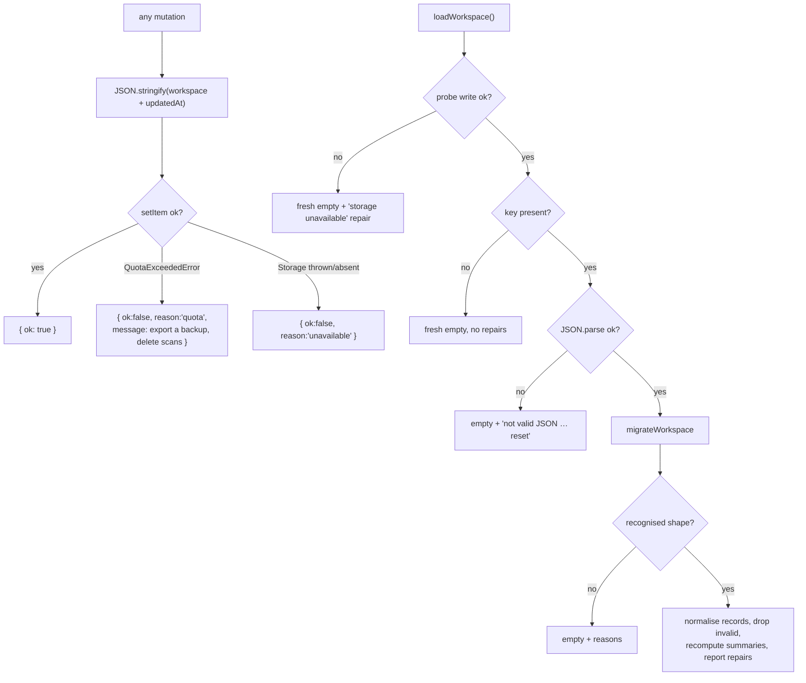

# Data flow

Each workflow follows the same discipline:

```
Input → Validation → Transformation → State/Storage → Processing → Output
```

with an explicit error path at every stage.

---

## 1. Capture and audit

**Purpose.** Turn pasted HTML into an immutable, reproducible set of findings.



| Stage | Detail |
| --- | --- |
| **Input** | `markup` (string), `projectId`, `name`, optional `url`/`template`. |
| **Validation** | `validateScanInput` — project must exist, name 1–120 chars, URL ≤ 2048, markup non-empty and ≤ `LIMITS.maxCaptureBytes` (UTF-8 bytes, not characters). |
| **Transformation** | Trim + truncate; run the engine; each `EngineFinding` becomes a `Finding` with an id, `status:'open'`, `note:''`, and the scan's `createdAt`. |
| **Storage** | Whole workspace written to `a11y-workbench:workspace`. On quota failure the in-memory state still updates so the work can be exported. |
| **Processing** | Engine only: no time, no randomness, no I/O. Rule order fixed; output sorted. |
| **Output** | A `Scan` with `summary` and `findings[]`, plus `warnings[]` (engine warnings + pruning notice). |
| **Error path** | Validation error → inline field message. Engine rule crash → warning, scan still saved. Save failure → persistent banner, scan still usable. |

**Key invariant:** engine output is copied, never referenced. Later triage edits
`Finding.status`/`note`/`updatedAt` only — the engine's message, remediation,
selector and snippet are never rewritten, so the evidence stays reproducible.

---

## 2. Triage



| Stage | Detail |
| --- | --- |
| Input | `scanId`, `findingId`, `status` (and optionally a note). |
| Validation | Unknown ids are a no-op (no crash, no phantom record). Notes are trimmed and capped at 500 characters. |
| Transformation | Only that finding's `status`/`note`/`updatedAt` change. |
| Storage | Persisted immediately — triage is a save-per-action workflow, deliberately (a lost triage decision is worse than a few extra writes). |
| Processing | Selectors recompute counts; `buildConformance` recomputes status. |
| Output | Updated badge, updated project progress, updated report. |
| Error path | Save failure → banner + the change stays on screen. |

The note field saves on **blur**, not per keystroke: 40 keystrokes must not mean
40 localStorage writes.

---

## 3. Report generation

```mermaid
flowchart TD
  W["workspace.scans (project)"] --> Pick{"include all scans?"}
  Pick -->|No (default)| Latest["latest scan only"]
  Pick -->|Yes| All["all scans"]
  Latest --> Findings["included.flatMap(scan.findings)"]
  All --> Findings
  Findings --> Counts["countBySeverity(open only)"]
  Findings --> Conf["buildConformance(latest scan)"]
  Latest --> Input["ReportInput { project, scans, generatedAt }"]
  Counts --> Input
  Conf --> View["ReportDetailScreen"]
  Input --> MD["buildMarkdownReport"]
  Input --> HTML["buildHtmlReport"]
  Findings --> CSV["findingsToCsv"]
  MD --> DL["downloadTextFile(.md)"]
  HTML --> DL2["downloadTextFile(.html)"]
  CSV --> DL3["downloadTextFile(.csv)"]
  HTML --> Print["window.print()"]
```

| Stage | Detail |
| --- | --- |
| Input | Project id from the route; triage state from the workspace. |
| Validation | Deleted project → "gone" screen. No scans → empty state with a route to capture, and exports disabled. |
| Transformation | Conformance mapping (see below); severity counts exclude resolved findings; `generatedAt` is injectable for deterministic tests. |
| Storage | None. Reports are generated on demand, so they cannot be stale. |
| Processing | Pure string building. |
| Output | HTML (standalone, printable), Markdown, CSV, or the printed page. |
| Error path | Exporters cannot throw on valid input; all interpolation is escaped/quoted. |

### Conformance mapping

| Finding state for a rule | Reported status | Reason |
| --- | --- | --- |
| Rule produced no findings | *(row absent — treated as supported)* | The rule evaluates inapplicable and passing pages identically, so the report does not claim a pass for a rule it cannot distinguish. This is stated in the report body. |
| Findings exist, none resolved | **Does not support** | A barrier is present on the capture. |
| Some resolved, some not | **Partially supports** | Improvement measured, barrier remains. |
| All resolved (fixed/accepted/ignored) | **Partially supports** | Deliberately conservative: a documented exception (accepted/ignored) is not full conformance. |

This is the honest mapping, not a marketing one. It is documented in the product
(report body) and in the code (`buildConformance` docstring).

---

## 4. Persistence, load and repair



Repairs are surfaced verbatim in the app-wide warning banner, so an auditor knows
data was dropped rather than silently losing a record.

---

## 5. Backup and restore

| Stage | Detail |
| --- | --- |
| Input | A `.json` file chosen by the user (max 40 MB). |
| Validation | Non-empty; parseable JSON; either `{app, workspace}` or a bare workspace; must yield a usable workspace with ≤ 100 projects. |
| Transformation | `migrateWorkspace` normalises it exactly like `localStorage` data — one code path, so an import cannot introduce a shape the app cannot persist. |
| Storage | Replaces the whole workspace in one write. |
| Output | Toast with the repair count when records were dropped. |
| Error path | Specific messages: empty file, invalid JSON, not a workspace, too many projects, save failed. |

---

## 6. Contrast check (tool flow)

```
text input → parseColor → null? inline error, no result
                        → ok → contrastRatio + assessContrast(normalText | largeText | ui)
                             → ratio, required threshold, pass/fail, AA|AAA
```

The checker exists precisely because the engine's `contrast-inline` rule cannot
see external stylesheets. It is documented as the manual companion to the
automated rule.

---

## Data shape at each hop

| Hop | Shape | Notes |
| --- | --- | --- |
| Clipboard → dialog | raw string | untrusted |
| Dialog → validator | `CreateScanInput` | trimmed |
| Validator → engine | string | unchanged |
| Engine → repository | `EngineFinding[]` + `ScanSummary` | no ids |
| Repository → store | `Scan` (with `Finding[]`) | ids, status, notes |
| Store → localStorage | `Workspace` JSON | single key |
| Store → selectors | in-memory objects | never deep-copied (documents are replaced, not mutated) |
| Selectors → UI | plain numbers/arrays | memoised per render |
| UI → exporters | `ReportInput` | pure |
| Exporters → blob | text | escaped per format |
