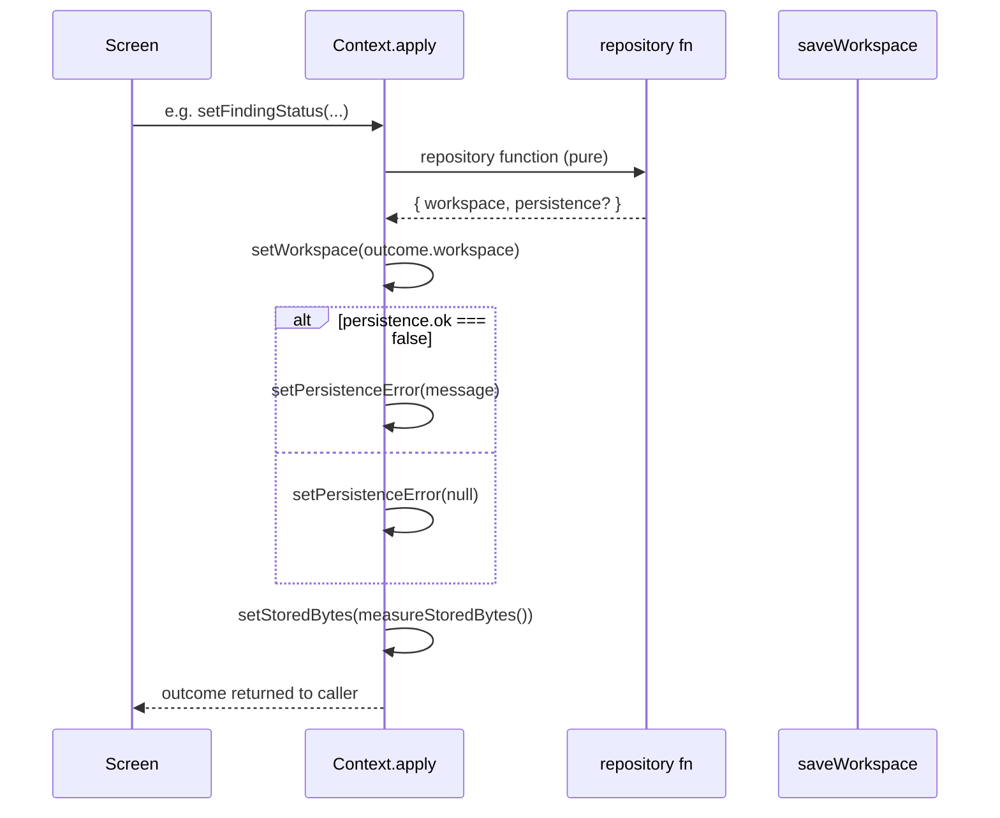

# State management

## Model

One store, one provider, one write path.

```
WorkspaceProvider (src/state/workspace-context.tsx)
├── workspace        : Workspace        — the only persisted state
├── ready            : boolean          — effects have run
├── loadWarnings     : string[]         — repairs from the last load
├── persistenceError : string | null    — set when the last write failed
├── storedBytes      : number           — for the settings screen
└── toasts           : Toast[]          — transient feedback queue
```

Derived values are **not** stored. They are computed by
`src/state/selectors.ts` inside `useMemo` at the screen that needs them, so there
is exactly one definition of "open findings" or "resolution percent".

## Why a context instead of a state library

| Option | Verdict | Reason |
| --- | --- | --- |
| `useState` per screen | Rejected | The workspace must be shared across nine routes and survive navigation. |
| Redux / Zustand / Jotai | Rejected | One store, one reducer-shaped update path already exists. A library would move the same 150 lines behind an API and add a dependency. |
| React Context + `useMemo` | Chosen | Zero dependencies; the store is small; re-render cost is bounded because every mutation replaces the workspace object (referential change signals updates). |

**Revisit when:** someone needs undo/redo across the whole document, or the store
grows beyond ~5 distinct slices. At that point a reducer with a command log is
the natural evolution, and `repository.ts` already returns next-state values,
which is the shape a reducer needs.

## Update path

Every mutation has the same four steps, implemented once in `apply()`:



Consequences:

* **A failed save cannot be silent.** The banner is driven by
  `persistenceError`, which is only cleared by a successful write.
* **The UI never shows stale data after a failed save.** The in-memory workspace
  is always the attempted state; the banner explains why the disk disagrees.
* **Callers get the outcome** so a dialog can decide whether to close.

## Concurrency and stale closures

`WorkspaceProvider` reads `workspace` from its render scope, so a mutation
function closes over the workspace of the render in which it was created. Two
consequences, both deliberate:

1. Within one React render pass, two mutations would both start from the same
   snapshot and the second would win. No UI path does this: each action is a
   discrete user event, and React processes the resulting state update before the
   next event.
2. Cross-tab editing is **not** supported. Two tabs have independent in-memory
   snapshots and the last write wins. This is documented as a limitation in
   [`../OPERATIONS.md`](../OPERATIONS.md) with the mitigation (one tab per
   workspace; export before switching).

**Revisit when:** multi-tab support becomes a requirement. The fix is to read the
latest workspace from storage inside the mutation (`repository` functions already
take the workspace as an argument), plus a `storage` event listener to reconcile.

## Memoisation strategy

| Where | Why |
| --- | --- |
| `useMemo(() => loadWorkspace(), [])` | Loading must happen exactly once per mount. |
| `useMemo(value, [workspace, ready, …])` on the context value | Prevents every consumer re-rendering when only a toast changes… except that toasts are in the same object. This is the known cost: a toast re-renders all consumers. It is accepted because toasts are rare and the screens are cheap. |
| Per-screen `useMemo(selector, [workspace, filters])` | Selectors walk all findings; recomputing on unrelated renders would be wasteful during typing in filters. |
| `useCallback` on `apply`, `notify`, `dismissToast` | Keeps the context value stable between renders that do not change data. |

The memo below is intentionally **not** keyed on `toasts` in the screens: no
screen reads `toasts`, but they still re-render because context is one object. If
this ever becomes measurable, the fix is to split the toast queue into its own
provider — a contained change (only `ToastRegion` and `notify` consumers touch
it).

## Toast lifecycle

```
notify(tone, message, action?)
  → push { id, tone, message, action }
  → keep at most 4 (slice(-3) + new)
  → auto-dismiss after 6 s (9 s for errors)
  → dismissToast clears the timeout and removes the entry
  → on unmount, all timers are cleared (stale snapshot taken at mount)
```

Toasts are for *feedback*, never for the only copy of important information:
persistence failures also appear as a persistent banner, and validation errors
appear inline on the field.

## Theme state

Theme lives outside the workspace (separate key) because a workspace reset should
not change the user's appearance preference. `useTheme` owns:

* `mode` (`light` | `dark` | `system`) — persisted;
* `resolved` (`light` | `dark`) — what is actually applied;
* a `matchMedia` listener that re-applies `system` when the OS changes.

`lib/theme-init.ts` applies the same resolution **before React mounts** to avoid a
theme flash; `useTheme` then takes over. The duplication is deliberate (one runs
before module evaluation completes, the other reacts to changes) and both read the
same key and the same media query.

## Routing state

The URL is the source of truth. `useRoute` subscribes to `hashchange`, parses the
hash into `{ name, segments }`, and returns it. Screens receive ids as props from
`App.tsx` and look the entity up in the workspace; a missing entity renders the
"gone" screen. Nothing about navigation is kept in React state, so refresh,
deep-link and Back all behave.

## What is intentionally not in state

| Thing | Why |
| --- | --- |
| Selected project | It is in the URL (`#/projects/:id`). |
| Filter selections in `FindingsScreen` | Session-local by design; not worth persisting and would surprise a user returning days later. |
| Scroll position | Not restored; screens are short. |
| Undo history | Not implemented. Destructive actions use a two-step confirmation instead. |
| Server cache | There is no server. |
