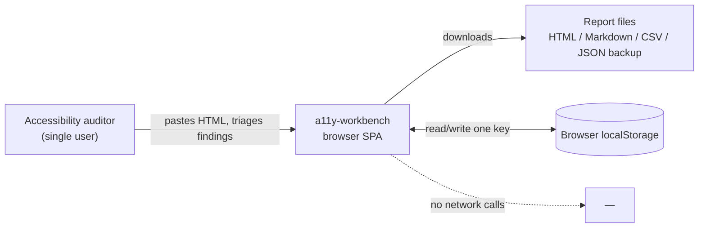
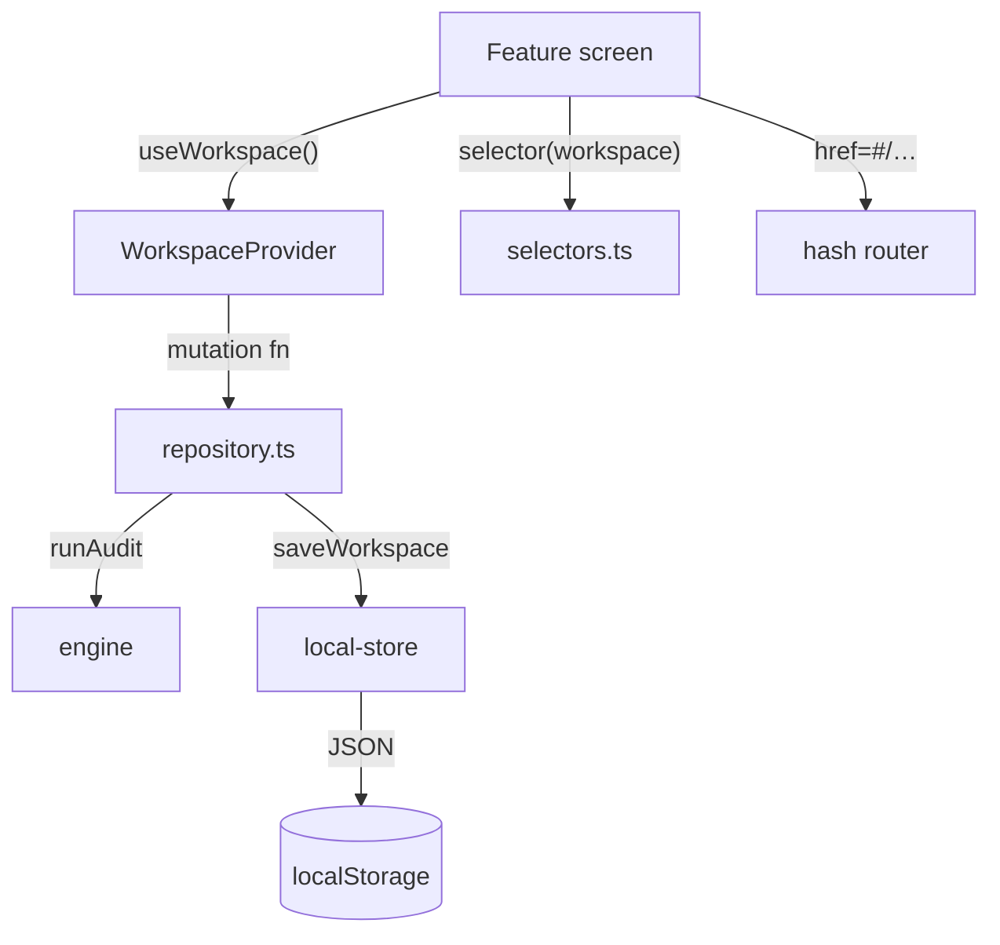

# System overview

## Purpose

Describe what the system is composed of, what each part is responsible for, how
the parts talk to each other, and which parts are allowed to know about which.

## Context diagram

There are no external services. The only I/O is `localStorage` and user-initiated
file downloads/uploads (via `<input type="file">` and Blob URLs, which never
leave the machine).

## Subsystem map

| # | Subsystem | Entry point | Depends on | Used by |
| --- | --- | --- | --- | --- |
| 1 | Domain model | `src/types/domain.ts` | — | all |
| 2 | Configuration | `src/config.ts` | Vite env | all |
| 3 | Pure utilities | `src/lib/*` | config, domain | engine, storage, features |
| 4 | Audit engine | `src/engine/audit.ts` | domain, config, lib | repository |
| 5 | Storage & schema | `src/storage/*` | domain, config, lib, engine | state |
| 6 | State & routing | `src/state/*` | storage, engine, domain | features |
| 7 | UI primitives | `src/components/ui/*` | domain, config | features, layout |
| 8 | App shell | `src/components/layout/*` | state, ui | App |
| 9 | Feature screens | `src/features/*` | all of the above | App |
| 10 | Exporters | `src/features/reports/exporters.ts` | domain, lib, state/selectors | report screens |

## Communication

There is no message bus, no event emitter and no server. Communication is:

1. **Direct function calls** for pure work (`runAudit`, selectors, exporters).
2. **React context** for shared state (`useWorkspace()`), so any screen can read
   the workspace and call a mutation without prop drilling.
3. **Hash changes** for navigation (`location.hash`), so history and deep links
   work without a router library.

## Boundary rules (what each subsystem may not do)

| Subsystem | Forbidden |
| --- | --- |
| Domain model | Importing anything. |
| Engine | React, storage, `Date.now()`, `Math.random()`, mutating the document. |
| Storage | Rendering; importing features or components. |
| State | Containing screen markup (only the provider component). |
| UI primitives | Importing `storage/**` or `engine/**`. |
| Features | Mutating `workspace` objects directly (they must go through context mutations). |
| Styles | Colours outside `tokens.css`. |

These are conventions, not enforced by a linter. Violating them will not fail the
build, but it will make the pure test suites weaker — which is the real cost.

## Data ownership

| Data | Owner (write) | Readers |
| --- | --- | --- |
| `Workspace` | `repository.ts` via `WorkspaceProvider` | selectors, screens, exporters |
| Engine findings inside a scan | `repository.createScan` (copied from engine output, never mutated afterwards) | findings screens, reports, CSV |
| Triage state (`status`, `note`) | `repository.updateFinding` / `bulkUpdateFindings` | findings screens, conformance |
| Theme preference | `hooks/useTheme` | `theme-init`, CSS via `data-theme` |
| Toasts | `WorkspaceProvider` | `ToastRegion` |
| Route | browser `location.hash` | `useRoute` |

## Scale assumptions

| Dimension | Assumed | Consequence if exceeded |
| --- | --- | --- |
| Projects per workspace | ≤ 100 (enforced) | Extra projects are dropped on save |
| Scans per project | ≤ 25 default (enforced, configurable to 500) | Oldest pruned with a warning |
| Findings per scan | ≤ 400 default (enforced, configurable to 5000) | Extras dropped with a warning |
| Markup per capture | ≤ 512 KB default (enforced, configurable to 8 MB) | Capture rejected before the engine runs |
| Total workspace | Single-digit MB (localStorage limit is typically 5–10 MB) | Quota error surfaced with recovery guidance |

These bounds are what keep a single-key `localStorage` design viable. See
[`../PERFORMANCE.md`](../PERFORMANCE.md) for what happens near the limits.
