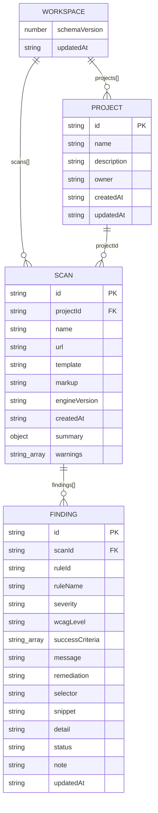

# Storage schema

## Technology

| Property | Value |
| --- | --- |
| Store | Browser `localStorage` |
| Key | `a11y-workbench:workspace` (constant `STORAGE_KEY` in `src/config.ts`) |
| Format | JSON document, whole workspace per write |
| Schema version | `3` (`SCHEMA_VERSION`) |
| Concurrent writers | Not supported — last write wins across tabs |
| Size limit | Browser quota (typically 5–10 MB per origin); failures are typed and surfaced |
| Encryption | None — plain text in the browser profile |
| Server | None |

## Entity relationship



## Keys, relationships and cascade rules

| Relationship | Cardinality | Enforced by |
| --- | --- | --- |
| `Workspace → Project` | 1 : 0..100 | `LIMITS.maxProjects` in `createProject` and `migrateWorkspace` |
| `Project → Scan` | 1 : 0..25 (default) | Pruning in `createScan`; orphans dropped on load |
| `Scan → Finding` | 1 : 0..400 (default) | Cap in `runAudit`; findings live inside the scan (no separate collection) |

There are **no foreign key constraints** in storage. Referential integrity is
maintained by the repository:

| Operation | Effect |
| --- | --- |
| Delete project | Its scans (and therefore their findings) are removed in the same write |
| Delete scan | Its findings disappear with it (embedded) |
| Prune old scans | Only for that project; other projects untouched |
| Load | Scans whose `projectId` is unknown are dropped with a repair message |

## Indexes and query performance

No indexes exist — the workspace is small enough to scan linearly. Where lookups
happen:

| Lookup | Implementation | Cost |
| --- | --- | --- |
| Project by id | `projects.find` (`getProject`) | O(projects) ≤ 100 |
| Scan by id | `scans.find` (`getScan`) | O(scans) ≤ 2500 worst case |
| Scans of a project | `filter` + `sort` (`projectScans`) | O(scans log scans) |
| Findings across workspace | `flatMap` (`allFindings`) | O(findings), memoised per screen |

`FindingsScreen` builds a `Map<projectId, name>` once per render for its filter
rather than calling `getProject` per row.

## Constraints and validation

Validation happens at three points:

1. **Input** — `validateProjectInput` / `validateScanInput` before a mutation.
2. **Repository** — bounds (name length, note length, caps) applied on write, so a
   programmatic caller cannot bypass the form.
3. **Load** — `migrateWorkspace` normalises everything read from disk or a backup:
   types coerced/rejected, enums defaulted, strings bounded, `summary` recomputed.

| Field | Constraint |
| --- | --- |
| `Project.name` | 1–120 chars, trimmed |
| `Project.description` | ≤ 1000 chars |
| `Project.owner` | ≤ 120 chars |
| `Scan.name` | 1–120 chars |
| `Scan.url` | ≤ 2048 chars |
| `Scan.markup` | 1 … `maxCaptureBytes` (default 512 KB, UTF-8) |
| `Finding.status` | one of `open`, `in_progress`, `fixed`, `accepted`, `ignored` |
| `Finding.severity` | one of `critical`, `serious`, `moderate`, `minor` |
| `Finding.wcagLevel` | one of `A`, `AA`, `AAA` |
| `Finding.note` | ≤ 500 chars |
| `Finding.snippet` | ≤ 240 chars at write time (`SNIPPET_LENGTH`) |
| `Scan.warnings` | ≤ 20 strings |

## Migrations

There is no per-version step function because every change so far has been
additive and can be defaulted field-by-field. `migrateWorkspace`:

1. rejects non-objects and documents without `projects`/`scans` arrays (`reset`);
2. reads `schemaVersion` (default 1 when absent/invalid);
3. logs "upgraded from N" or "written by a newer version";
4. normalises projects → scans (dropping orphans) → findings;
5. recomputes every `summary`;
6. stamps `schemaVersion = 3`.

**Adding a field:** add it to `types/domain.ts`, normalise it in `schema.ts`, bump
`SCHEMA_VERSION`. If the change is *not* defaultable (a rename or restructure), add
an explicit branch keyed on the stored version — the hook exists, it is simply
unused so far.

**Adding an enum value:** update the type, the label map, the ordering array, the
allowed-values list in `schema.ts`, badges/selects, and the tests that assert
counts.

## Seed data

None. A first run yields an empty workspace and the onboarding state. Demo content
is provided by the two bundled samples, which the user explicitly loads — the app
never writes data it did not receive from a user action.

## Backup

| Aspect | Detail |
| --- | --- |
| Format | `{ app: 'a11y-workbench', exportedAt, workspace }`, pretty-printed JSON |
| Name | `a11y-workbench-backup-YYYY-MM-DD.json` |
| Content | Everything, including captured markup and audit notes |
| Restore | Full replacement, validated through `migrateWorkspace` |
| Size limit | 40 MB on import |

Backups are the only migration path between browsers or profiles. Because
`localStorage` is unencrypted, a backup file is also unencrypted — treat it as
confidential.

## Data lifecycle

```
capture → scan stored (open findings) → triage updates status/note
        → scan pruned when a project exceeds its scan cap (oldest first)
        → project deleted = all its scans and findings deleted
        → workspace reset = everything cleared (plus clearWorkspace)
```

Nothing else deletes data. There is no automatic expiry, no background cleanup
and no soft delete.

## Failure and recovery

| Failure | Data effect | Recovery |
| --- | --- | --- |
| Quota on write | Previous document intact; new change in memory only | Export backup, delete scans, retry |
| Storage unavailable | Nothing persisted (session only) | Enable site data |
| Invalid JSON | Document unreadable; workspace reset in memory | Restore a backup (the bad document is preserved until the next write) |
| Partial record corruption | Invalid records dropped, rest kept | Repair messages list what was lost |
| Browser profile cleared | Everything gone | Restore a backup |

**Important:** the app never writes over a corrupt document until the user makes a
change. If a load fails, the old bytes are still in place, which is why "restore a
backup" can be attempted. It also means a corrupt document survives until the first
mutation, then is replaced — do not assume the corrupt copy is recoverable after
editing.

## Inspecting storage manually

```js
// In the browser console on the app's origin
JSON.parse(localStorage.getItem('a11y-workbench:workspace'))
copy(localStorage.getItem('a11y-workbench:workspace'))    // copy for a bug report
localStorage.removeItem('a11y-workbench:workspace')       // hard reset
```
