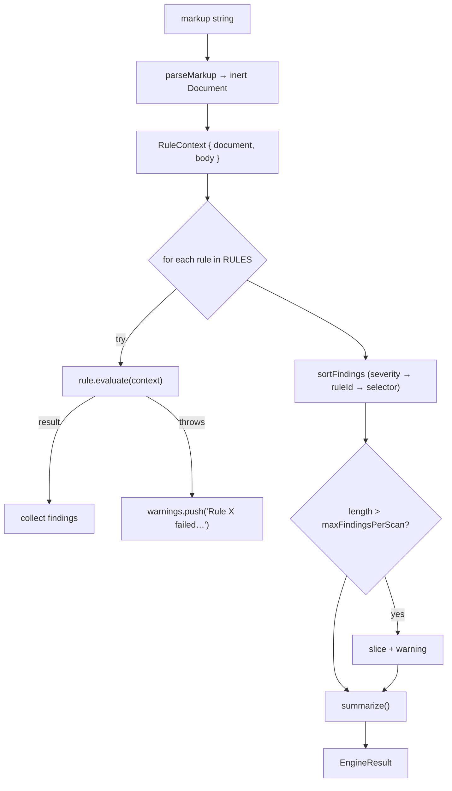

# Module: audit engine

**Location.** `src/engine/` — `audit.ts`, `finding.ts`, `types.ts`,
`rules/index.ts`, `rules/shared.ts`, one file per rule.
**Consumers.** `src/storage/repository.ts` (`createScan`), `RulesScreen`,
`SettingsScreen`, tests.
**Depends on.** `src/types/domain.ts`, `src/config.ts`, `src/lib/dom.ts`.

## Purpose

Convert captured markup into a deterministic, explainable list of accessibility
violations, each carrying the rule that produced it, a severity, a WCAG level, an
element selector, an evidence snippet and remediation guidance.

## Public interface

```ts
runAudit(markup: string): EngineResult
summarize(findings: EngineFinding[], rulesEvaluated: number): ScanSummary
ENGINE_VERSION: string            // '1.0.0'
RULES: readonly Rule[]            // ordered registry (19 entries)
RULE_DESCRIPTORS                  // rule metadata without evaluate()
```

`EngineResult` = `{ engineVersion, findings, summary, warnings }`.

## Contracts

| Contract | Meaning | Enforced by |
| --- | --- | --- |
| Deterministic | Same markup + same `ENGINE_VERSION` ⇒ identical output, including order | `sortFindings`; 35 tests |
| Total | Never throws, for any string input | per-rule `try/catch`, parse `try/catch`; tests on `'<'.repeat(500)` |
| Pure | No I/O, no `Date`, no `Math.random` | code review; no such imports |
| Non-mutating | Rules must not modify the parsed `Document` | documented; caches depend on it |
| Bounded | Output capped at `LIMITS.maxFindingsPerScan` with a warning | `runAudit` |

## Internal architecture



## Rule contract

```ts
interface Rule extends RuleDescriptor {
  evaluate(context: { document: Document; body: Element }): EngineFinding[];
}
```

Rules call `violation(rule, { element, message, remediation?, detail?, severity? })`
so metadata can never be omitted. `severity` may be overridden for a weaker
instance of the same rule (used by `page-title` for a generic title).

## Data structures

```ts
EngineFinding {
  ruleId, ruleName, severity, wcagLevel, successCriteria[],
  message, remediation, selector, snippet, detail?
}
ScanSummary {
  total, bySeverity{critical,serious,moderate,minor},
  passedByLevel{A,AA,AAA}, rulesEvaluated
}
```

`passedByLevel` counts **rules that produced no findings**, bucketed by the rule's
WCAG level. It is a coverage signal, not a conformance claim (a rule for a widget
the page does not have also counts as a "pass" — this is why the report omits
rather than claims).

## Rule catalogue

All 19 rules, in registry order:

| # | Rule id | File | Severity | WCAG | SC | What it detects |
| --- | --- | --- | --- | --- | --- | --- |
| 1 | `document-lang` | `rules/document-lang.ts` | serious | A | 3.1.1 | Missing or malformed `<html lang>` |
| 2 | `page-title` | `rules/page-title.ts` | serious (minor for a generic title) | A | 2.4.2 | Missing / generic `<title>` |
| 3 | `image-alt` | `rules/image-alt.ts` | critical | A | 1.1.1 | `` without `alt` (not presentational) |
| 4 | `button-name` | `rules/button-name.ts` | critical | A | 4.1.2, 2.4.6 | Button with no accessible name |
| 5 | `link-name` | `rules/link-name.ts` | serious | A | 2.4.4, 4.1.2 | Link with no name, or vague text ("click here", "read more") without `aria-label` |
| 6 | `form-label` | `rules/label.ts` | critical | A | 1.3.1, 3.3.2, 4.1.2 | Unlabelled input/select/textarea, or placeholder-only labelling |
| 7 | `heading-order` | `rules/heading-order.ts` | moderate | AA | 1.3.1, 2.4.6 | No `h1`, multiple `h1`, or skipped levels |
| 8 | `list-structure` | `rules/list-structure.ts` | moderate | A | 1.3.1 | Non-`li` child in `ul`/`ol`, empty list, invalid `dl` child |
| 9 | `table-header` | `rules/structure.ts` | serious | A | 1.3.1 | Data table (≥2 rows) with no `th`, not `role="presentation"` |
| 10 | `fieldset-legend` | `rules/structure.ts` | moderate | A | 1.3.1, 3.3.2 | `fieldset` without `legend`/`aria-label` |
| 11 | `bypass-blocks` | `rules/structure.ts` | moderate | A | 2.4.1 | No `main`/`role="main"` **and** no skip link |
| 12 | `landmark-structure` | `rules/structure.ts` | moderate | AA | 1.3.1, 2.4.1 | Duplicate unnamed `main`/`banner`/`contentinfo` |
| 13 | `interactive-semantics` | `rules/structure.ts` | critical | A | 2.1.1, 4.1.2 | Click-only non-native element without role+tabindex+key handler |
| 14 | `tabindex-order` | `rules/structure.ts` | moderate | A | 2.4.3 | Positive `tabindex` |
| 15 | `svg-name` | `rules/structure.ts` | serious | A | 1.1.1, 4.1.2 | Inline `<svg>` without `title`/`aria-label` (skips `aria-hidden`) |
| 16 | `aria-role-valid` | `rules/aria.ts` | serious | A | 4.1.2 | `role` value not in the ARIA role list |
| 17 | `aria-required-attributes` | `rules/aria.ts` | serious | A | 4.1.2 | Role missing its required state attribute |
| 18 | `aria-attribute-valid` | `rules/aria.ts` | serious | A | 4.1.2 | Misspelled/unknown `aria-*` attribute |
| 19 | `contrast-inline` | `rules/contrast-style.ts` | serious | AA | 1.4.3 | Inline fg+bg pair below 4.5:1 (3:1 large) |

### Severity policy

| Severity | Definition | Examples |
| --- | --- | --- |
| critical | Blocks a user from completing a task at all | missing `alt`, unlabelled field, click-only control, unnamed button |
| serious | Major barrier or misleading experience | missing page language, vague link text, invalid ARIA, contrast failure |
| moderate | Degrades structure/navigation | heading order, list markup, missing landmark, positive tabindex |
| minor | Polish | generic page title |

Severity is **per rule**, not per instance, except for the documented
`page-title` override. It reflects user impact, not fix effort — a `critical` is
cheap to fix and that is the point.

## Rule implementation notes

* **`shared.ts`** provides `auditable()` (query + hidden filter) so all rules skip
  content removed from the accessibility tree, and shares the control/type sets.
* **Name computation** lives in `lib/dom.accessibleName` and follows this order:
  `aria-labelledby` → `aria-label` → `alt` → associated `<label>` → wrapping
  `<label>` → own text (non-form-controls only) → `title`. It returns `''` only
  when every mechanism is empty, which is why a labelled control is never flagged.
* **`contrast-inline`** only evaluates elements with **both** `color` and
  `background-color` inline. It caps at 50 findings per page. It cannot see
  external CSS — that gap is the reason the contrast checker screen exists.
* **`aria-attribute-valid`** deliberately avoids the generic `auditable('*')`
  path: validating an attribute name needs no visibility walk, so it checks the
  attribute first and only then the hidden state. This is a measured optimisation
  (see `PERFORMANCE.md`).

## Error handling

| Failure | Behaviour |
| --- | --- |
| Empty/whitespace markup | Warning "every rule was skipped", empty result |
| Unparseable markup | Warning with the parser message, empty result |
| A rule throws | Warning naming the rule + message; other rules continue |
| A rule returns a non-array | Warning "returned no result and was ignored" |
| Output exceeds the cap | Sorted slice + warning with both counts |

## Performance

Measured in Node 22 + jsdom (method and caveats in
[`../PERFORMANCE.md`](../PERFORMANCE.md)):

| Input | Median | Findings |
| --- | --- | --- |
| 2 KB sample (failing) | 10.9 ms | 20 |
| 3 KB sample (accessible) | 10.3 ms | 0 |
| 23 KB, 100 rows | 59.7 ms | 301 |
| 119 KB, 500 rows | 210.8 ms | 400 (capped) |
| 238 KB, 1000 rows | 385.1 ms | 400 (capped) |

Scaling is linear in element count after the ADR-006 fixes.

## Security considerations

* Markup is parsed with `DOMParser` (`text/html`) — inert: no script execution, no
  subresource fetches.
* The engine never writes to the DOM; findings carry escaped-safe strings that
  consumers must escape (exporters do).
* No `innerHTML` is used anywhere in the engine.

## Common failure modes

| Symptom | Cause | Diagnosis |
| --- | --- | --- |
| Findings missing for hidden content | Working as designed (`aria-hidden`, `hidden`, inline `display:none`) | Remove the hiding attribute to confirm |
| A labelled field reported | Label is not associated (e.g. `<span>` next to input, no `for`/wrapping) | Check `accessibleName` order |
| No contrast findings | Colours come from a stylesheet, not `style=""` | Expected — use the contrast checker |
| Output order changed | `ENGINE_VERSION` bumped | Compare versions stored on the scans |

## Extension points

* **Add a rule:** create `src/engine/rules/<name>.ts` exporting a `Rule`, register
  it in `rules/index.ts`, add fixtures + tests, add it to the rule table above.
  Keep the id stable forever.
* **Change severity/SC:** edit the rule's descriptor; existing scans keep their
  stored values (evidence immutability).
* **New WCAG level:** extend `WcagLevel` in `types/domain.ts` and
  `summarize`'s `passedByLevel` initialiser.

## Debugging procedure

```bash
# 1. Reproduce with the exact markup
node --experimental-strip-types -e "…"   # or use the test harness

# 2. Isolate a single rule
npx vitest run src/engine/audit.test.ts -t "rule: image-alt"

# 3. Inspect one rule's output on a fixture
#    add a temporary console.log inside the rule — removed before commit
```

In the browser: the scan detail screen shows the exact captured markup
("Show captured markup") and the selector for every finding, so a finding can be
located by re-opening the capture.

## Modification risks

| Change | Risk |
| --- | --- |
| Renaming a rule id | Breaks historical findings (they store the old id); reports will show unknown rules |
| Making a rule mutate the document | Invalidates `lib/dom` caches → stale hidden/label results |
| Removing `sortFindings` | Output order becomes registry order; report diffs become noisy |
| Raising the cap without raising storage limits | Quota failures on save |
