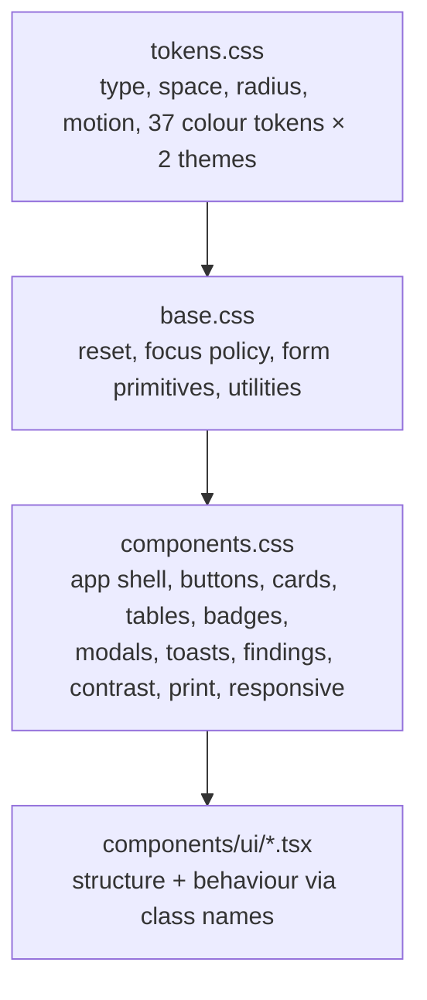

# Module: design system

**Location.** `src/styles/tokens.css`, `src/styles/base.css`,
`src/styles/components.css`, plus the primitives in `src/components/ui/`.
**Consumers.** Every component and screen.

## Structure



Three layers, one direction. Component CSS never redefines a token value; it only
consumes `var(--…)`.

**Verified exception list.** Every colour in `components.css` and `base.css` comes
from a token except five literals, all inside `@media print` (`#fff`, `#000`,
`#999`, `#eee`, `#000`). Print is a different medium with its own contrast model —
paper is white and a themed dark surface would waste toner and reduce legibility —
so those are intentional and confined to that block. Everything else, including the
modal and mobile-menu scrims (`--scrim`), the brand mark and the primary button
label (`--text-inverse`), resolves through a token.

## Tokens

| Group | Values | Notes |
| --- | --- | --- |
| Type scale | 11, 12, 13, 14, 16, 18, 22, 28, 34 px | 14 px base; 11 px only for uppercase eyebrows |
| Weights | 400, 500, 600, 700 | 600 for titles, 500 for controls |
| Line heights | 1.2 (titles), 1.35 (snug), 1.55 (body) | |
| Spacing | 4 px scale to 64 px | every gap uses it |
| Radius | 4, 6, 10, 14, pill | inputs/buttons 6, cards 10, modals 14 |
| Layout | sidebar 264 px, content max 1240 px, touch target 44 px | |
| Motion | 110 ms fast, 170 ms base | disabled under `prefers-reduced-motion` |
| Colour | 37 per theme (36 palette + `--scrim`) | see below |

### Colour tokens (both themes)

Both theme blocks declare **the same 41 colour properties** (37 palette/scrim plus
4 shadow compositions) — verified by diffing the two blocks, so nothing silently
inherits a light value in dark mode.

Surfaces: `bg-canvas`, `bg-surface`, `bg-surface-raised`, `bg-subtle`, `bg-inset`,
`bg-hover`, `bg-selected`, `scrim`.
Borders: `border-strong`, `border-default`, `border-subtle`, **`border-control`**.
Text: `text-primary`, `text-secondary`, `text-muted`, `text-inverse`.
Accent: `accent`, `accent-hover`, `accent-active`, `accent-soft`,
`accent-border`, `focus-ring`.
Status: `critical-*`, `serious-*`, `moderate-*`, `minor-*`, `success-*`
(each has `-fg`, `-bg`, `-border`).

`--scrim` is semi-transparent by design: it is an overlay, not a text background,
so it is exempt from the 3:1 control-boundary requirement.

**Why `border-control` exists:** `border-default` (a hairline divider) is 1.38:1
against white — fine for decoration, but a form control's boundary must reach 3:1
under SC 1.4.11. A separate token was added (`#828c99` light, `#66717f` dark) and
is used by inputs, selects, textareas and buttons. It is guarded by
`src/test/tokens-contrast.test.ts`.

## Measured contrast

All pairs verified by `src/test/tokens-contrast.test.ts` (28 assertions) and by an
ad-hoc run reported in [`../ACCESSIBILITY.md`](../ACCESSIBILITY.md). Representative
values:

| Pair | Light | Dark |
| --- | --- | --- |
| text-primary / surface | 17.6:1 | 15.55:1 |
| text-secondary / surface | 7.87:1 | 9.32:1 |
| text-muted / surface | 5.22:1 | 6.22:1 |
| text-muted / canvas | 4.83:1 | 6.74:1 |
| accent / surface | 8.56:1 | 7.83:1 |
| control border / surface | 3.41:1 | 3.52:1 |
| focus ring / canvas | 7.92:1 | 10.31:1 |

## Focus policy

```css
:focus-visible { outline: 2px solid var(--focus-ring); outline-offset: 2px; }
```

* `:focus-visible` only — mouse clicks do not draw rings, keyboard always does.
* Outline is never removed; inputs additionally get a soft `box-shadow` ring.
* The skip link is the first tab stop and is visually hidden until focused
  (`transform: translateY(-200%)` → `0`), so it does not occupy layout.

## Responsive strategy

| Breakpoint | Change |
| --- | --- |
| ≤ 1100 px | Contrast checker becomes single-column |
| ≤ 960 px | Sidebar becomes an off-canvas panel with a scrim; menu toggle appears; content padding shrinks |
| ≤ 720 px | Smaller page titles; card/table/finding padding reduces; toolbars stack; modals' footer buttons stretch; detail grids become single column |
| ≤ 480 px | Content padding 12 px; toasts full-width; stat grid min column 140 px; project grid single column |

Tables never cause page-level horizontal scrolling: they are wrapped in
`.table-wrap { overflow-x: auto }`, and `th`/`td` keep a readable minimum.

## Component conventions

| Convention | Rule |
| --- | --- |
| Buttons | Always `.button` + one modifier (`--primary`, `--danger`, `--ghost`) + optional `--sm`/`--icon` |
| Cards | `.card` + `.card-header` / `.card-body` / `.card-footer`; `--flush` when a table/list must meet the edges |
| Badges | `.badge` + tone; always contain a word, never colour alone |
| Alerts | `.alert` + tone; `role="alert"` only when the error appears after an action |
| Empty states | `.empty-state` with icon, title, explanatory body and at least one action |
| Modals | One `.modal` implementation; never a bespoke overlay |
| Icons | One component, 24 px grid, 1.7 stroke, always `aria-hidden` |

## Print

`@media print` hides navigation, the top bar, toasts and any `.no-print` element,
removes shadows, converts to `#fff` background and `11pt` text, keeps table header
backgrounds light, and avoids breaking cards/sections across pages.

## Forced colours and reduced motion

* `@media (forced-colors: active)` restores `CanvasText` borders on inputs and
  buttons, which are otherwise lost when the system overrides colours.
* `@media (prefers-reduced-motion: reduce)` reduces all transitions and
  animations to 0.01 ms (kept non-zero so `transitionend` listeners still fire,
  and because removing them entirely can leave `animation-fill-mode` states
  stuck).

## Adding a component

1. Add a `.component` block to `components.css` using tokens only.
2. If it needs a new colour, add a token to **both** theme blocks in `tokens.css`.
3. If it is a new text/control pair, add it to `src/test/tokens-contrast.test.ts`.
4. Build the React part in `components/ui/` (primitives) or `features/` (screen
   composition) — not both.

## Modification risks

| Change | Risk |
| --- | --- |
| Editing a colour token | Silently changes contrast everywhere; the token test catches text/control pairs but not decorative use |
| Using a raw hex in a component | Bypasses both themes; breaks the guarantee. Only the `@media print` block is allowed to do this |
| Raising `--text-2xs` usage for body text | 11 px is below comfortable reading size for long text |
| Removing `:focus-visible` styling | Keyboard users lose their position — a WCAG 2.4.7 failure |
