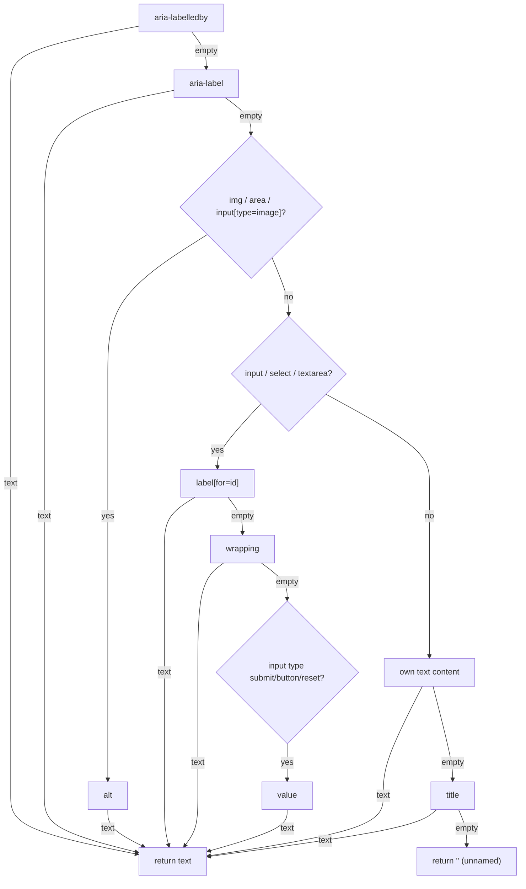

# Module: DOM utilities

**Location.** `src/lib/dom.ts`
**Consumers.** The audit engine (every rule), `features/reports/exporters.ts`
(`escapeHtml`), tests.
**Depends on.** `src/config.ts` (`SNIPPET_LENGTH`) only.

## Purpose

Two jobs that must not be mixed with rule logic:

1. **Security boundary** — turn untrusted markup into an inert document and make
   every string safe for the format it is written into.
2. **DOM queries** — the DOM facts rules need (accessible name, visibility,
   selector path, evidence snippet), implemented efficiently and memoised.

## Public interface

| Function | Signature | Purpose |
| --- | --- | --- |
| `parseMarkup` | `(markup: string) => Document` | Parse with `DOMParser`, `text/html`; never throws |
| `escapeHtml` | `(value: string) => string` | Escape `& < > " '` |
| `normalizeWhitespace` | `(value: string) => string` | Collapse runs of whitespace, trim |
| `isHiddenFromAT` | `(element: Element) => boolean` | Element **or any ancestor** removed from the a11y tree |
| `buildSelector` | `(element: Element) => string` | Stable CSS path, id short-circuit |
| `snippetOf` | `(element: Element) => string` | Truncated single-line `outerHTML` |
| `queryAll` | `(root: ParentNode, selector: string) => Element[]` | Document-order query |
| `isNativelyFocusable` | `(element: Element) => boolean` | Default focusability |
| `textOf` | `(element: Element) => string` | Normalised text content |
| `accessibleName` | `(element: Element) => string` | Heuristic AccName computation |
| `visibleText` | `(element: Element) => string` | Text with `img`/`svg` substitutes |
| `attributesOf` | `(element: Element) => Record<string,string>` | Lower-cased attribute map |
| `resetDomCaches` | `() => void` | Clear the memo caches (tests only) |

## How the accessible name is computed

Order (first non-empty wins):



Deliberate choices:

* **Form controls never take their name from their own content.** A `<select>`
  contains option text and an `<input type=submit>` contains a value; counting
  those as labels is the classic false-negative that makes a linter useless. This
  was a real bug found by a test (`select` reported as unlabelled).
* **`title` is last.** It is the weakest mechanism and often a tooltip, but it is
  a valid accessible name, so it prevents a false positive.
* **`aria-label` beats content.** Matches the spec's precedence for naming from
  author-provided labels.

**Limitations (documented, not hidden):** no `aria-describedby` fallback, no
role-based name-from-content rules (e.g. `role="button"` with an image child is
handled only via `alt`), no `aria-labelledby` resolution outside the parsed
document. These are acceptable because the rules only report when *nothing* is
found.

## Caches

Three `WeakMap` caches, keyed by DOM node, valid because the engine never mutates
a parsed document:

| Cache | Key → value | Why |
| --- | --- | --- |
| `hiddenCache` | `Element → boolean` | Stops repeated ancestor walks; results propagate down the visited path |
| `labelForCache` | `Document → Map<id, label>` | One pass per document instead of a `querySelector` per control |
| `formControlLabelCache` | `Element → string` | Avoids recomputing `textOf(label)` |
| `siblingIndexCache` | `Element → ParentIndex` | Selector-path positions without `Array.from(children)` per ancestor |

`resetDomCaches()` swaps in fresh maps. It is only needed if a caller mutates a
document between audits — no production path does.

## buildSelector

```
input#email                      ← id short-circuit
body > main > h1                 ← unique tag at each level
body > main > p:nth-of-type(2)   ← only when siblings share the tag
```

The index is built **lazily and incrementally**: for a link in the second cell of
a 100-row table, only two children of the row are indexed, not a hundred. Positions
are stored, so a later element forcing a full scan does not make earlier lookups
quadratic. This is the single largest performance fix in the project (see
`PERFORMANCE.md`).

## isHiddenFromAT

Considers, on the element and every ancestor:

* `aria-hidden="true"`
* `hidden` attribute
* `type="hidden"`
* inline `display: none` / `visibility: hidden`

It does **not** consider stylesheet-driven hiding (a class with
`display:none`) — that information is not present in a capture. Consequence:
content hidden by an external stylesheet may be reported. This is stated in the
product's limitations.

## Failure behaviour

Nothing here throws on any input:

* `parseMarkup` is total (the HTML parser repairs anything).
* `accessibleName`, `textOf`, `snippetOf` return `''` for detached or empty nodes.
* `buildSelector` returns `'body'`-rooted paths or an empty string when the element
  is not in a document.

## Modification risks

| Change | Consequence |
| --- | --- |
| Removing the caches | Audit time returns to quadratic on large pages |
| Making a rule mutate the document | Caches return stale values |
| Changing name order | Findings change silently; `ENGINE_VERSION` must be bumped |
| Changing selector format without a note | Stored selectors in existing scans still display (they are strings), but new scans look different |
