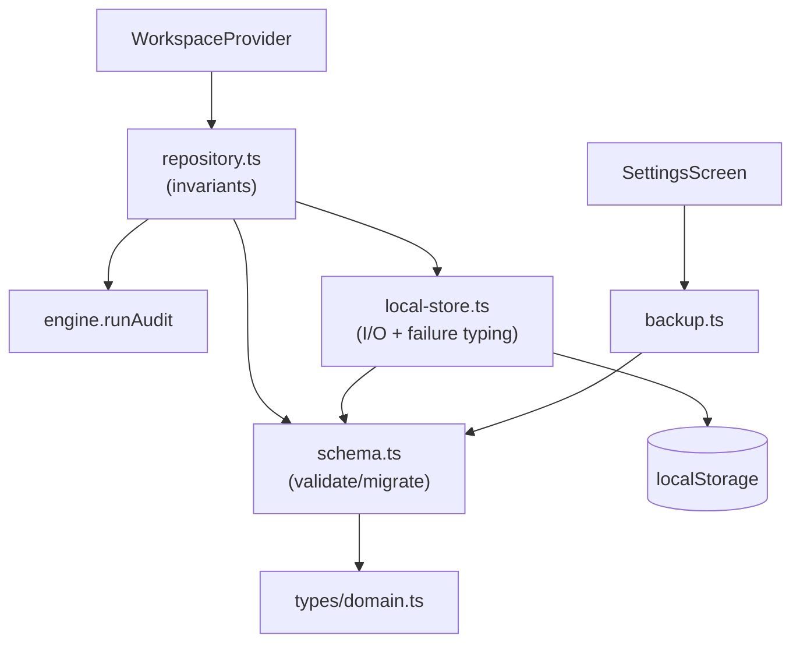

# Module: storage and repository

**Location.** `src/storage/` — `schema.ts`, `local-store.ts`, `backup.ts`,
`repository.ts`.
**Consumers.** `src/state/workspace-context.tsx` (via repository),
`SettingsScreen` (backup), tests.
**Depends on.** `src/types/domain.ts`, `src/config.ts`, `src/lib/format.ts`,
`src/lib/id.ts`, `src/engine/audit.ts`.

## Purpose

Be the only code that reads or writes persisted data, enforce every invariant of
the workspace, and translate every storage failure into a typed result the UI can
act on.

## Layer map

## `schema.ts`

| Export | Purpose |
| --- | --- |
| `emptyWorkspace()` | Valid current-schema document |
| `migrateWorkspace(raw)` | `{ workspace, repairs, reset }` — never throws |
| `isEngineFinding(value)` | Shape guard used on import |

**Normalisation rules** (per record):

| Field | Rule |
| --- | --- |
| strings | must be string; bounded to the field's max length; otherwise `''`/default |
| ISO dates | parsed; invalid ⇒ epoch ISO string |
| enums (`severity`, `wcagLevel`, `status`) | must be in the allowed set; otherwise a safe default (`moderate`, `A`, `open`) |
| `findings` | non-objects dropped and counted; ids synthesised if missing |
| `summary` | **recomputed** from surviving findings (never trusted from disk) |
| orphan scans | dropped when `projectId` is unknown, with a repair message |
| projects | capped at `LIMITS.maxProjects` |
| `schemaVersion` | stamped to current; older ⇒ "upgraded" repair; newer ⇒ warning |

**Why recompute the summary:** it is derived data. A stored summary that
disagrees with its findings would produce wrong counts in the UI and the report.

## `local-store.ts`

| Export | Returns | Failure typing |
| --- | --- | --- |
| `loadWorkspace()` | `{ workspace, fresh, repairs, bytes }` | Never throws; problems become `repairs` strings |
| `saveWorkspace(ws)` | `{ ok } \| { ok:false, reason, message }` | `reason` ∈ `quota` \| `unavailable` \| `unknown` |
| `clearWorkspace()` | `SaveResult` | as above |
| `measureStoredBytes()` | number | returns 0 on error |

**Availability probe.** `getStorage()` performs a real `setItem`/`removeItem` of a
probe key. Safari private mode and some enterprise policies expose
`localStorage` but throw on write; without the probe the app would look fine
until the first save.

**Quota detection** covers `QuotaExceededError`, `NS_ERROR_DOM_QUOTA_REACHED`
(Firefox legacy) and any error whose message matches `/quota/i`.

## `backup.ts`

| Export | Purpose |
| --- | --- |
| `createBackup(ws)` | `{ app:'a11y-workbench', exportedAt, workspace }` |
| `serializeBackup(ws)` | Pretty JSON (diffable, reviewable) |
| `parseBackup(text)` | `{ ok, workspace?, message }`; 40 MB cap; accepts the envelope or a bare workspace |
| `downloadBackup(ws)` | Blob download (also re-exported behaviour via `lib/download`) |

Import goes through `migrateWorkspace`, so a backup cannot introduce a shape the
app cannot persist.

## `repository.ts`

The invariant layer. Every function takes the current workspace, returns
`{ workspace, persistence? }`, and never mutates its input.

| Function | Invariants enforced |
| --- | --- |
| `createProject` | trim, max length, max 100 projects, timestamps, `updatedAt` touched |
| `updateProject` | only supplied fields change, trimmed and bounded |
| `deleteProject` | cascades to that project's scans |
| `createScan` | validation → engine → ids → `status:'open'` → prune per project → cap |
| `deleteScan` | removes all its findings with it |
| `updateFinding` | unknown ids are a no-op; note trimmed/bounded; `updatedAt` updated |
| `bulkUpdateFindings` | only the given ids, single write |
| `replaceWorkspace` | full replacement (restore), timestamps touched |
| `resetWorkspace` | valid empty document |

Shared validators (`validateProjectInput`, `validateScanInput`) are exported so
the forms and the repository cannot diverge.

**Persistence failure policy:** the in-memory change is kept even when the write
fails, and the failure is returned. Rationale: a lost triage decision is worse
than a stale disk, and the user can still export.

## Data structures

The repository operates on the domain model directly (`Workspace`, `Scan`,
`Finding`). It introduces no new persisted types — `MutationOutcome` is
transient.

## Error handling summary

| Layer | Never throws | Reports via |
| --- | --- | --- |
| `schema` | yes | `repairs[]`, `reset` |
| `local-store` | yes | `repairs[]` (load) or `SaveResult` (write) |
| `backup` | yes | `{ ok:false, message }` |
| `repository` | yes (validation returns a message) | `persistence`, `warnings[]` |

## Performance

| Operation | Cost (measured) |
| --- | --- |
| `saveWorkspace` at realistic size | ~1–3 ms (JSON stringify + `setItem`) |
| `createScan` | engine time (see PERFORMANCE.md) + copy of findings |
| `loadWorkspace` | parse + normalise, linear in records |

The whole-document write is the documented trade-off in ADR-004.

## Security considerations

* Stored data is **unencrypted** — `localStorage` is readable by any script on the
  origin. Stated in Settings and SECURITY.md.
* `migrateWorkspace` is the trust boundary for anything from disk or a file: it
  never evaluates code, never trusts a summary, and bounds every string.
* Imported backups cannot create more than 100 projects.

## Common failure modes

| Symptom | Cause | Diagnosis |
| --- | --- | --- |
| "Changes are not being saved" | quota or blocked storage | Settings shows bytes used; check DevTools → Application → Local Storage |
| Workspace resets on load | invalid JSON or unrecognised shape | The banner lists which; restore a backup |
| Project disappeared | >100 projects on save | Migration repair message |
| Scans vanished | project deleted (cascade) or pruned at the per-project cap | Pruning emits a warning at capture time |
| Second tab overwrites the first | last-write-wins across tabs | Documented limitation |

## Extension points

* **New mutation:** add a function that returns `MutationOutcome` and wire it in
  the context's `value` memo. Keep the input workspace untouched.
* **New persisted field:** add to `types/domain.ts`, normalise in `schema.ts`
  (this is the step people forget), then use it.
* **New storage backend:** implement the four `local-store` functions and swap the
  import; `repository.ts` and all UI stay unchanged.

## Modification risks

| Change | Risk |
| --- | --- |
| Skipping normalisation for a new field | Field silently becomes `undefined` after reload |
| Trusting the stored `summary` | Counts drift from findings |
| Removing the availability probe | Private-mode users see silent data loss |
| Removing pruning | Quota failures become the normal experience |
