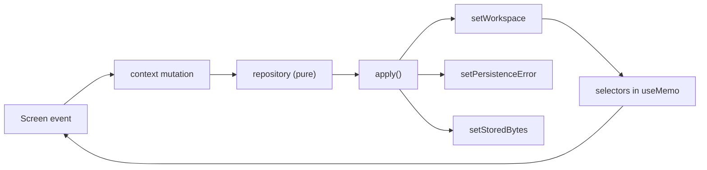

# Module: workspace state

**Location.** `src/state/workspace-context.tsx` (provider), `src/state/selectors.ts`
(derived data).
**Consumers.** Every feature screen, `AppShell` (nav counts), `App` (banners).
**Depends on.** `src/storage/*`, `src/types/domain.ts`, `src/lib/format.ts`.

## Purpose

Hold the workspace for the session, make every mutation safe (surface persistence
failures), queue user feedback, and expose a single, stable API to screens.

## Public interface — `useWorkspace()`

### Read

| Field | Type | Meaning |
| --- | --- | --- |
| `workspace` | `Workspace` | Projects + scans + findings |
| `ready` | `boolean` | Effects have run (first paint is already loaded) |
| `loadWarnings` | `string[]` | Repairs from the last load (banner) |
| `persistenceError` | `string \| null` | Last write failure (persistent banner) |
| `storedBytes` | `number` | Serialised size for Settings |
| `toasts` | `Toast[]` | Feedback queue |

### Write

| Method | Returns |
| --- | --- |
| `addProject(input)` | `MutationOutcome` |
| `editProject(id, patch)` | `MutationOutcome` |
| `removeProject(id)` | `MutationOutcome` (cascades) |
| `addScan(input)` | `MutationOutcome & { scan?, warnings? }` |
| `removeScan(id)` | `MutationOutcome` |
| `setFindingStatus(scanId, findingId, status, note?)` | `MutationOutcome` |
| `setFindingNote(scanId, findingId, note)` | `MutationOutcome` |
| `bulkSetFindings(scanId, ids, status)` | `MutationOutcome` |
| `restoreBackup(workspace)` | `MutationOutcome` |
| `resetAll()` | `void` (clears storage + memory) |
| `refreshStoredBytes()` | `void` |
| `notify(tone, message, action?)` | `void` |
| `dismissToast(id)` | `void` |

## `apply()` — the single update funnel

```ts
const apply = (outcome: MutationOutcome): MutationOutcome => {
  setWorkspace(outcome.workspace);
  if (outcome.persistence && !outcome.persistence.ok) {
    setPersistenceError(outcome.persistence.message ?? 'Changes could not be saved.');
  } else {
    setPersistenceError(null);
  }
  setStoredBytes(measureStoredBytes());
  return outcome;
};
```

Every mutation goes through it, so it is impossible to add a mutation that
silently ignores a failed save.

## Selectors

`src/state/selectors.ts` — all pure, all taking a workspace/scan/finding list.

| Selector | Returns | Used by |
| --- | --- | --- |
| `countBySeverity(findings)` | `SeverityCounts` (+ `total`) | overview, scan detail, reports |
| `countByStatus(findings)` | per-status counts | scan detail |
| `isResolved(finding)` | `boolean` | everywhere "resolved" is decided |
| `openFindings(findings)` | `Finding[]` | overview, inbox defaults |
| `projectScans(ws, id)` | scans, newest first | project detail, reports |
| `allFindings(ws)` | flat list | overview, reports |
| `latestScanByProject(ws)` | `Map<projectId, Scan>` | overview, projects |
| `workspaceStats(ws)` | projects, scans, findings, open, resolved, percent, unaudited, latest activity | overview, shell |
| `aggregateByRule(findings)` | per-rule occurrences + open counts | overview |
| `buildConformance(scan)` | VPAT rows | report detail, Markdown |
| `severityTrend(scans)` | chronological open-finding points | available for trend UI (not currently rendered) |
| `getProject` / `getScan` | entity or `undefined` | screens |
| `searchFindings(findings, query)` | filtered list | inbox |

`severityTrend` is implemented and tested but not rendered in a screen; it is
listed as an extension point rather than dead code (it is used by tests and is the
obvious basis for a trend chart).

## Toast queue

| Property | Value |
| --- | --- |
| Max visible | 4 (oldest dropped) |
| Auto-dismiss | 6 s; 9 s for `error` |
| Optional action | one, e.g. retry/undo |
| Live region | `ToastRegion` sets `aria-live="assertive"` only when an error toast exists |

Timers are tracked in a `Map` and cleared on unmount and on manual dismissal, so a
dismissed toast cannot fire a stale `setState`.

## State flow



## Error handling

| Case | Behaviour |
| --- | --- |
| Persistence failure | `persistenceError` set; banner in `App`; cleared by the next successful write |
| Mutation with unknown ids | Repository no-op; no error shown (nothing was lost) |
| Validation failure before mutation | Caller shows field error; context not involved |
| Storage unavailable at load | `loadWarnings` explain it; the session is in-memory |
| Toast callback throws | Not caught (it is app code); the error boundary handles render errors |

## Performance considerations

* The context value is memoised on all its fields, including `toasts`, so a toast
  re-renders all consumers. Accepted (rare, cheap screens); see
  `architecture/state-management.md` for the split-provider fix if it ever matters.
* Selectors are memoised per screen on `[workspace, filters]`.
* `setStoredBytes(measureStoredBytes())` reads the whole stored string per
  mutation. It is a single `getItem` on a small document; if the workspace grows
  large this should move behind `refreshStoredBytes()` called only by Settings.

## Extension points

* Add a mutation: repository function first, then expose it here through `apply`.
* Add derived data: add to `selectors.ts`, never compute aggregates in a screen.
* Split toasts into their own provider if re-render cost appears in a profile.

## Modification risks

| Change | Risk |
| --- | --- |
| Bypassing `apply()` | Failed saves become silent — the one behaviour the product promises |
| Storing derived values in state | Two sources of truth; numbers diverge between UI and exports |
| Reading `workspace` from a stale closure across awaits | Lost updates (no async mutation exists today; keep it that way without a re-read) |
