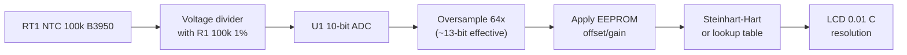

# Design

## What it is

A clinical digital thermometer: a 2-layer board small enough to sit inside a
12 × 35 mm housing, measuring body temperature over 35–42 °C and displaying it to
0.01 °C resolution with ±0.1 °C accuracy after factory calibration.

## Why the STC15W408AS

| Feature | Why It Wins |
| --- | --- |
| Cost | ~$0.12–$0.18 in volume (2024) — cheaper than STM8, PIC, or even barebones ATmega |
| Integration | Built-in 10-bit ADC, EEPROM, LCD segment driver (in some variants), high-current GPIOs → no external components needed |
| Voltage range | 2.4V–5.5V → runs directly from 2×AAA or CR2032 without regulator |
| No crystal needed | Internal ±1% RC oscillator → saves $0.03 and board space |
| Chinese ecosystem | STC Micro is China-based → easy supply chain, local support, no export restrictions |
| Toolchain | Free Keil C51-compatible compiler + free ISP programmer (USB-to-TTL) |

## Schematic

[`../hardware/clinical-thermometer.sch`](../hardware/clinical-thermometer.sch) is a
KiCad EESchema (file format version 4) schematic. Open it with KiCad's Eeschema.

| Block | Components |
| --- | --- |
| Power | BT1 (CR2032), C1 100 nF, C2 10 µF |
| Temperature sensor | NTC 100 kΩ B3950 (RT1) + R1 100 kΩ divider into an ADC channel |
| MCU | U1 STC15W408AS, SOP-20 |
| User interface | SW1 power button, R2 10 k pull-down, LCD1 custom 3.5-digit TN |
| Audio feedback | BZ1 piezo, R3 1 k current limit |

The schematic contains 21 component instances (including power symbols) and
terminates correctly with `$EndSCHEMATC`.

### Measurement chain

The divider is **ratiometric**: the same 3 V supply feeds the divider and the ADC
reference, so supply drift largely cancels. Temperature is computed from the
resistance ratio, not from an absolute voltage.

## Accuracy

| Parameter | Value |
| --- | --- |
| NTC tolerance | ±1% resistance → ±0.5–1.0 °C absolute error |
| ADC resolution | 10-bit → 1024 steps |
| Claimed resolution | 0.01 °C displayed |
| Claimed accuracy | ±0.1 °C (in 35–42 °C clinical range) |

### Resolution vs accuracy — read this carefully

Displaying 0.01 °C does **not** mean the reading is accurate to 0.01 °C. The two
numbers come from different places:

| | Comes from | Value |
| --- | --- | --- |
| Resolution | Oversampling (64 samples → √64 = 8× noise reduction) plus a sub-LSB lookup | 0.01 °C displayed |
| Accuracy | NTC tolerance, divider tolerance, ADC linearity, reference drift, self-heating, calibration quality | ±0.1 °C in the clinical range |

### A discrepancy in the source design (verified)

The original session stated that a 10-bit ADC over this range gives
**≈0.07 °C per step**, and separately that a 47 kΩ or 68 kΩ series resistor with
the 100 kΩ NTC "maximises ADC step count".

Recomputing the divider shows **both cannot be true as stated**. The BOM and
schematic use a 100 kΩ divider (R1), not 47 kΩ/68 kΩ.

| Divider (with NTC 100 kΩ, β = 3950, 10-bit) | Codes spanned, 35→42 °C | °C per code |
| --- | --- | --- |
| 33 kΩ | 67.7 | 0.103 |
| **47 kΩ / 68 kΩ** (source's recommendation) | 72.1 | **0.097** |
| **100 kΩ** (what the schematic actually uses) | 67.1 | **0.104** |
| 220 kΩ | 47.3 | 0.148 |

Over every divider from 10 kΩ to 300 kΩ the best case is **0.096 °C per code** — so
**0.07 °C/step is not reachable** with a 10-bit converter on this divider, whichever
resistor is chosen. (Two plausible explanations: the figure was derived for a
12-bit ADC, where ≈0.024 °C/code is achievable, or from a different NTC/β.)

**Consequence:** the uncalibrated quantisation floor is ≈0.10 °C, not 0.07 °C. That
is already close to the ±0.1 °C accuracy target, which makes oversampling and
per-unit calibration *more* necessary than the original text implied — oversampling
helps with noise and effective resolution, but it does not add real information
beyond the divider's sensitivity.

| | Source claim | Recomputed here | Status |
| --- | --- | --- | --- |
| 10-bit step size, clinical range | 0.07 °C | 0.097–0.104 °C depending on divider | **Source overstated** |
| Optimal divider | 47 kΩ / 68 kΩ | 47–68 kΩ is indeed the best region | Consistent |
| Divider in the schematic | — | 100 kΩ | Consistent with BOM, slightly off optimum |
| 0.01 °C displayed resolution | Yes, via oversampling | Achievable with averaging + interpolation | Consistent |
| ±0.1 °C accuracy | Yes, post-calibration | Not verified — no build was measured | **Design claim** |

This is recorded rather than quietly fixed: the schematic was taken from the source
as-is, so anyone using it should know that the accuracy budget is tighter than the
original narrative suggested.

The ±0.1 °C figure remains a *post-calibration* claim and depends on a real
calibration step (see [`calibration.md`](calibration.md)).

## Error budget

| Problem | Solution | Implemented Where |
| --- | --- | --- |
| NTC ±1% tolerance (±0.5–1°C absolute error) | Factory calibration at known temperature(s) | EEPROM stores offset/gain correction |
| 10-bit ADC too coarse (0.07°C/step in clinical range) | Oversample 64× → effective 13-bit | Firmware averaging loop |
| Non-linear NTC response | Steinhart-Hart equation OR lookup table with interpolation | Firmware ROM table |
| ADC noise | Same oversampling that improves resolution also reduces noise by √64 = 8× | Firmware |
| Displayed 0.01°C resolution | Combination of oversampling + calibrated lookup table | Firmware |

## Where this design must not be used

| Use Case | Why It Fails |
| --- | --- |
| Ambient room temperature (15–30 °C) | Poor sensitivity — few ADC steps → large quantization error |
| Industrial/oil/oven temps (>50 °C) | NTC may drift or age rapidly; no calibration outside 35–42 °C |
| Precision lab use (±0.01 °C accuracy) | Absolute accuracy is ±0.1 °C even after calibration — limited by ADC linearity, reference drift, PCB self-heating |
| Fast-changing temps (e.g., airflow) | Thermal mass too high — responds in seconds, not milliseconds |

## Firmware

[`../firmware/thermometer.c`](../firmware/thermometer.c) is the design sketch
recorded during the original session. It is **not buildable as-is** — see the
note at the top of that file and [`../README.md`](../README.md#status). It
documents the intended control flow:

* refuse to run uncalibrated (display `--CAL--` and halt),
* load a per-unit calibration offset from EEPROM,
* oversample the ADC 64× on a 200 ms timer tick,
* look up temperature, display it, beep when stable, show a fever icon above 38 °C,
* auto power-off after 8 minutes idle.

## Manufacturing

| Step | Process | Equipment | Time |
| --- | --- | --- | --- |
| 1 | Program STC15W chips (1000 pcs/batch) | Gang programmer (16-socket) | 3 min |
| 2 | Solder paste stencil | Semi-auto printer | 5 sec/board |
| 3 | Pick-and-place | Neoden 4 or CHMT560P4 | 12 sec/board |
| 4 | Reflow solder | 8-zone oven @ 240°C peak | 5 min/batch |
| 5 | AOI inspection | Automated optical | 2 sec/board |
| 6 | Calibration | Precision water bath + ISP | 30 sec/unit |
| 7 | Functional test | Auto press button + read display | 5 sec/unit |
| 8 | Assembly into housing | Manual/semi-auto | 10 sec/unit |

Programming happens **before** SMT placement; calibration happens **after**
assembly, because it corrects for the assembled board's actual NTC and divider.

## Design review — open questions

These are honest gaps rather than finished decisions:

| Question | Status |
| --- | --- |
| Is the LCD driver in the chosen STC15W variant segment-capable? | Not verified — the BOM note says "in some variants" |
| Battery life from a 220 mAh CR2032 at a 200 ms sampling duty cycle | Not computed |
| Does the housing allow the NTC to reach thermal equilibrium fast enough? | Not verified — thermal mass is the binding constraint |
| EMI/ESD protection on the exposed thermistor tip | Not present in the schematic |
| Waterproofing of the tip for clinical use | Not addressed |
