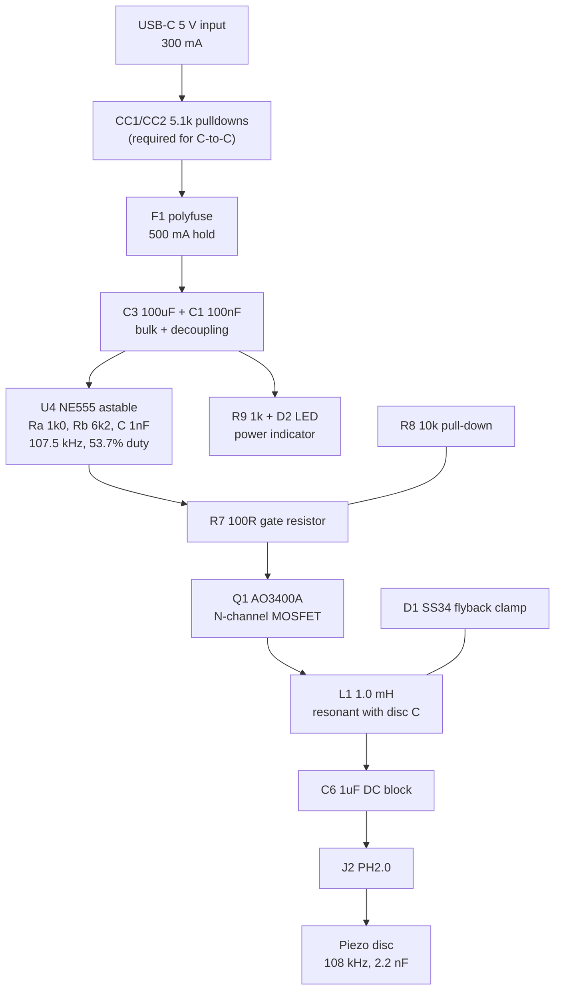

# Design

## What it is

A 5 V ultrasonic mist-maker driver: a 555 astable generates a ~107.5 kHz square
wave, which switches a MOSFET into an inductor–piezo resonant tank. The piezo disc
vibrates at ultrasonic frequency and shears the water surface into a fine mist.

This is a **documented alternative** to the commercial module it is based on — not
a clone of it. The original board uses a purpose-built driver IC; this design
replaces it with a 555 and discrete parts because those were the parts identified
in the source conversation. The consequences of that substitution are stated
plainly in [Known weaknesses](#known-weaknesses).

> **Status: designed and analysed, not prototyped.** The schematic, BOM and
> analysis are complete and the arithmetic is verified by
> [`../tools/verify_design.py`](../tools/verify_design.py). No board was built, no
> disc was driven, and no mist was measured. Output-rate and efficiency figures are
> estimates from the power budget, not measurements.

---

## Block diagram



## How the oscillation works

### 1. Carrier generation (555)

The 555 runs in astable mode:

```
f = 1.44 / ((Ra + 2·Rb) · C)
  = 1.44 / ((1000 + 2·6200) · 1e-9)
  = 107,463 Hz ≈ 107.5 kHz

duty = (Ra + Rb) / (Ra + 2·Rb) = 53.7 %
```

Note the duty cycle can never go below 50 % in a plain astable configuration —
a 555 limitation that matters here (see weaknesses).

Timing accuracy: the NE555's internal comparator thresholds drift with temperature
(roughly 50–200 ppm/°C), so the carrier moves by a few hundred hertz over a
0–85 °C range. That is tolerable against a ±3 kHz disc tolerance, but it is one
reason a real driver IC is better.

### 2. Switching (Q1)

The 555 output drives the AO3400A gate through R7 (100 Ω):

| Check | Value | Verdict |
| --- | --- | --- |
| Gate charge Qg | ≈ 6.5 nC | — |
| 555 source current | ≈ 200 mA | — |
| Charge time | ≈ 32 ns | 0.35 % of a 9259 ns period — fine |
| 555 output high | ≈ Vcc − 1.7 V = 3.3 V | Above Vgs(th), but marginal |
| Conduction loss at 0.3 A | 2.5 mW | negligible |
| Switching loss (tr = 50 ns) | ≈ 8 mW | negligible |
| **Total dissipation** | **≈ 11 mW** | ~3 °C rise in SOT-23 |

R8 (10 kΩ) holds the gate low before the 555 starts, so the FET is not
half-on during power-up.

### 3. Resonant tank (L1 + disc)

The piezo disc is a capacitor mechanically, typically **1.5–3 nF**. With L1 the
tank resonates at:

```
f = 1 / (2·π·√(L·C))
```

| L | Disc 2.2 nF | Match? |
| --- | --- | --- |
| 220 µH | 228.8 kHz | No — 2.1× too high |
| **1.0 mH** | **107.3 kHz** | **Yes** |
| 1.4 mH | 91.8 kHz | Too low |

The carrier (107.5 kHz) and the tank (107.3 kHz) are deliberately matched. In a
production design you would instead let the piezo self-oscillate and lock the drive
to it; here the two are simply tuned to agree at the nominal disc capacitance.

**D1 (SS34)** clamps the inductive kick when Q1 turns off each cycle, protecting
the MOSFET from the L·di/dt spike.

**C6 (1 µF)** blocks DC through the piezo. At 108 kHz its reactance is 1.47 Ω
against a transducer impedance of tens of ohms, so it is effectively a short at the
operating frequency while preventing a DC bias across the crystal.

### 4. Atomisation

The disc's tip displacement is largest at resonance, and the resulting capillary
waves on the water surface break into droplets ~3–5 µm in diameter. The disc must
be **1–3 mm below the surface** — too deep and the water damps the vibration, too
shallow and it sprays instead of atomising.

## Why a 555, and not the original IC

The commercial module uses a dedicated atomizer driver IC (marked U4 on the original
board, exact part unknown). That IC is better in every electrical respect:

| Aspect | Driver IC | This 555 design |
| --- | --- | --- |
| Waveform | Push-pull, symmetric | Single-ended, asymmetric |
| Duty cycle | Optimised | Fixed ≥ 50 % |
| Efficiency | Higher | Lower |
| Supply noise | Lower | Current spike at each 555 transition |
| Part count | ~8 | ~21 |
| Cost | ~$2–5 module | ~$2.60 in parts |
| Tuning | Self-oscillating with the disc | Fixed by L1 and C2 — must be retuned |

The 555 version wins on **buildability with common parts and understandability**.
It does not win on performance.

## Known weaknesses

Stated so nobody discovers them after building it:

| Weakness | Effect | Mitigation |
| --- | --- | --- |
| Marginal gate voltage (3.3 V) | Higher Rds(on), more switching loss | Use a logic-level FET with Vgs(th) < 2 V (e.g. IRLML2502) |
| 555 supply current spikes | Rail noise, possible reset | C5 100 nF at the IC, C3 100 µF bulk — both fitted |
| Duty cycle can't go below 50 % | Asymmetric drive, DC component in the tank | Add a diode across Rb to allow < 50 % duty |
| Fixed tuning | Mist stops if the disc's actual C differs much from 2.2 nF | Socketed inductor; retune per [`tuning.md`](tuning.md) |
| No closed-loop frequency tracking | Drift away from resonance as the disc heats | Out of scope for this build |
| Single-ended drive | Half the theoretical swing across the piezo | Push-pull half-bridge is the proper topology |
| 1.5 W input | ~20–30 mL/h realistic, not the 40–50 mL/h the source claimed | Accept it, or raise the supply |

## Power budget

| Quantity | Value |
| --- | --- |
| Input | 5 V × 0.3 A = **1.5 W** |
| Indicator LED | 5 V / 1 kΩ ≈ 3 mA ≈ 15 mW |
| 555 quiescent + switching | ≈ 20 mA ≈ 100 mW |
| Gate drive | ≈ 10 mW |
| Remainder to the tank | ≈ **1.3 W** |
| Realistic atomisation | **20–30 mL/h** |

The source claimed 40–50 mL/h at 1.5–2 W. That is optimistic by roughly 2×; see
[`CORRECTIONS.md`](CORRECTIONS.md#4-the-power-and-atomisation-figures-are-mutually-optimistic).

## Operating limits

| Parameter | Value |
| --- | --- |
| Supply | **5 V only.** 5.5 V is the practical ceiling for the NE555 |
| Current | 300 mA rated, 500 mA fuse hold |
| Ambient | 0–85 °C (board); water 0–60 °C |
| Humidity | 10–90 % RH, non-condensing — **the PCB must stay dry** |
| Duty | Continuous, but the disc erodes; see below |

**Disc life:** the piezoelectric ceramic erodes at the water interface. Commercial
modules typically lose output after a few hundred hours of continuous running.
Running dry destroys the disc in seconds.

## Assembly order

1. Solder the SMT parts first, small to large: 0603 passives, SOT-23, SMA, 0805,
   1206.
2. Fit the DIP-8 socket or the 555 directly.
3. Fit the through-hole parts: inductor L1, electrolytic C3, USB-C J1, PH2.0 J2.
4. **Do not** connect the disc until the 555 output has been verified (see
   [`tuning.md`](tuning.md)).
5. Power up with a current-limited bench supply at 5 V / 100 mA limit before using
   a USB charger.

## Safety

| Hazard | Control |
| --- | --- |
| Water + mains-adjacent electronics | Only the disc touches water. Seal the disc leads. Never let the PCB get wet |
| Dry running | Destroys the disc. Fit a water-level sense or never leave unattended |
| 5 V wiring to the disc | Keep leads short (< 10 cm) — long leads add inductance that detunes the tank |
| Inhalation | Use water only. Essential oils are the user's choice and are not evaluated here |
| Stray ultrasonic exposure | 108 kHz is above hearing, but do not hold the running disc against skin |

## Design review — open questions

| Question | Status |
| --- | --- |
| Actual capacitance of the specific disc the user has | **Unknown** — measure it, then set L1 |
| Does the 555's 3.3 V gate drive give acceptable Rds(on) for the chosen FET? | Marginal; a logic-level FET is recommended |
| Real atomisation rate of this build | **Not measured** — estimated 20–30 mL/h |
| Disc life under continuous duty | Not characterised |
| EMC: is a 108 kHz square wave a problem? | Not assessed; SS34 + C5 + C3 are the mitigations fitted |
| Thermal rise of L1 at 300 mA | Not computed; choose a part rated ≥ 500 mA |
